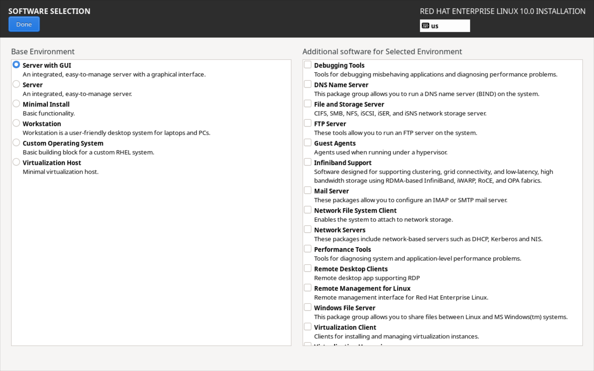
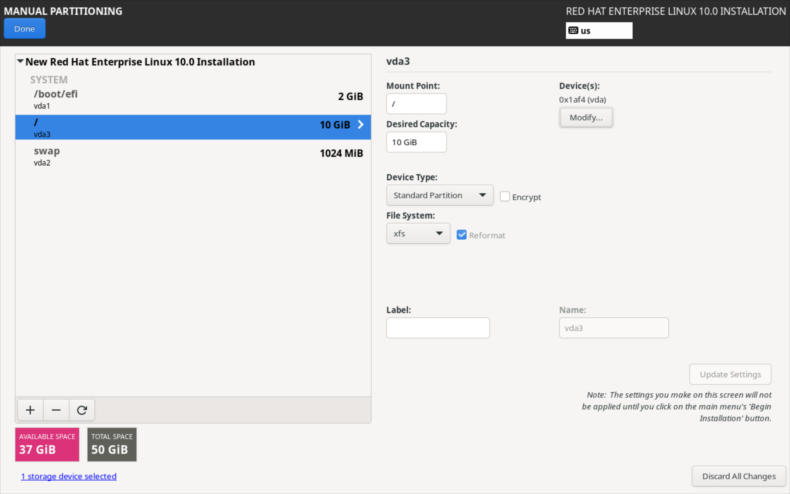
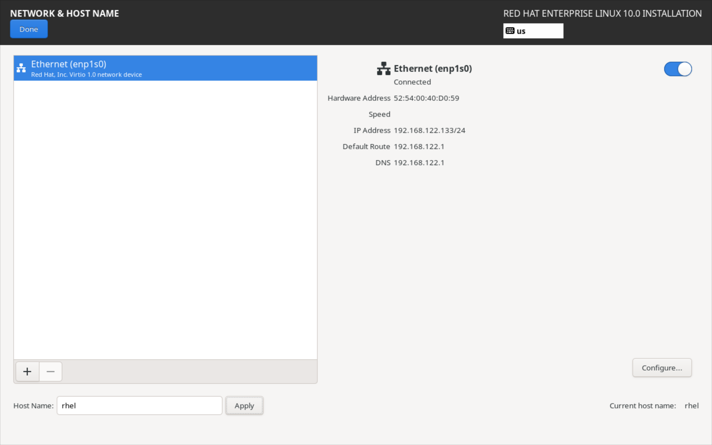
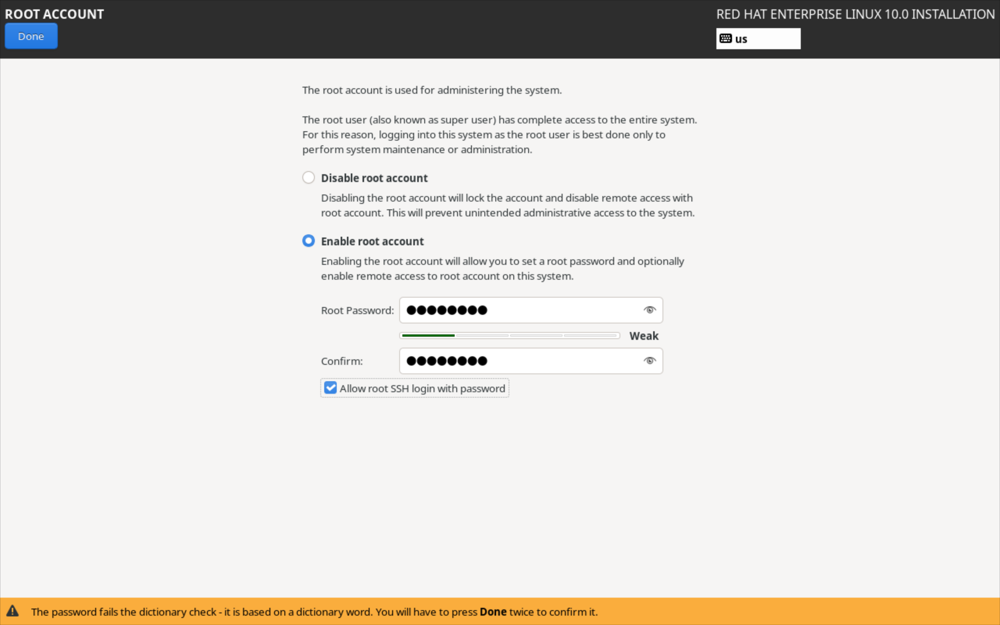
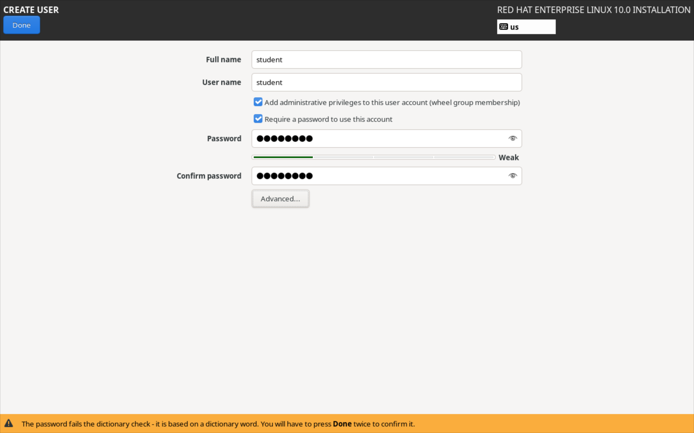

### Task: Lesson 2 Lab - Installing Red Hat Enterprise Linux

**Goal:** Install a RHEL Server with a graphical interface, custom partitioning, and DHCP networking, while configuring root and user accounts.

**Solution:**
1. **Software Selection**: During the installation process, select the "Server with GUI" base environment to ensure a graphical user interface is installed.

2. **Installation Destination (Partitioning)**: Configure custom manual partitioning with a 10GiB Root (`/`) partition, a 1GiB `swap` partition, and ensure at least 4GiB of disk space remains unused.

> **Note:** If installing on bare metal hardware or virtualized hardware with legacy BIOS, a `biosboot` partition is needed instead of `/boot/efi`.

3. **Network & Hostname**: Configure the primary network interface to connect automatically and obtain its IP address from a DHCP Server.

4. **Root Password**: Set the `root` user's password to `password` and confirm.

5. **User Creation**: Create a standard user named `student` with the password `password`.

