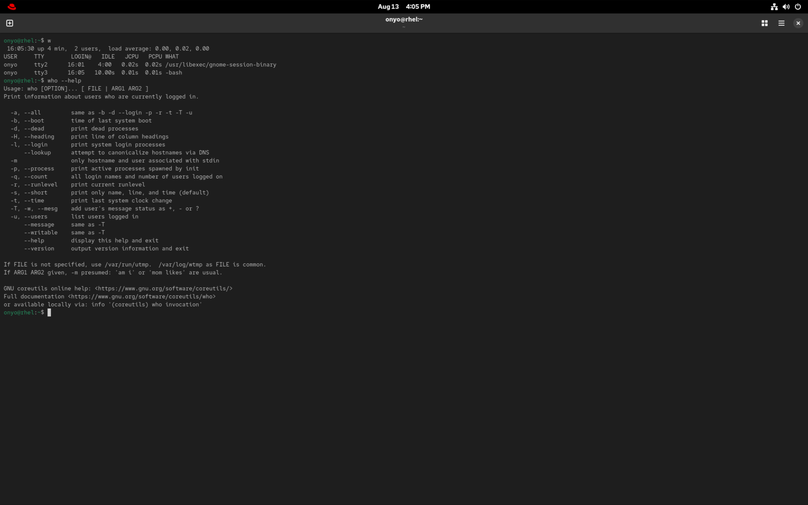

### Task: Lesson 3 Lab - Using the Command Line

**Goal:** Access the system graphically, open a terminal window, and use basic command-line utilities (`who`) to identify active users and learn how to view command help.

**Solution:**
1. Log in to the graphical desktop environment using your default user account.

2. Open a terminal window (typically found in the Applications menu or by pressing `Ctrl + Alt + T`).

3. Execute the `who` command to find out which users are currently active on the system:
```bash
who
#or just w
```

4. Use the `--help` flag to get a short usage overview and learn about available options for the `who` command:
```bash
who --help
```


