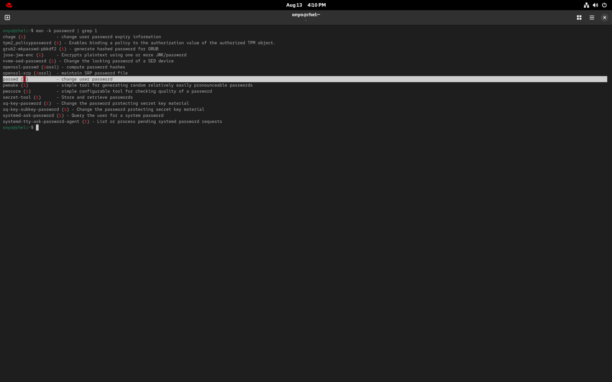
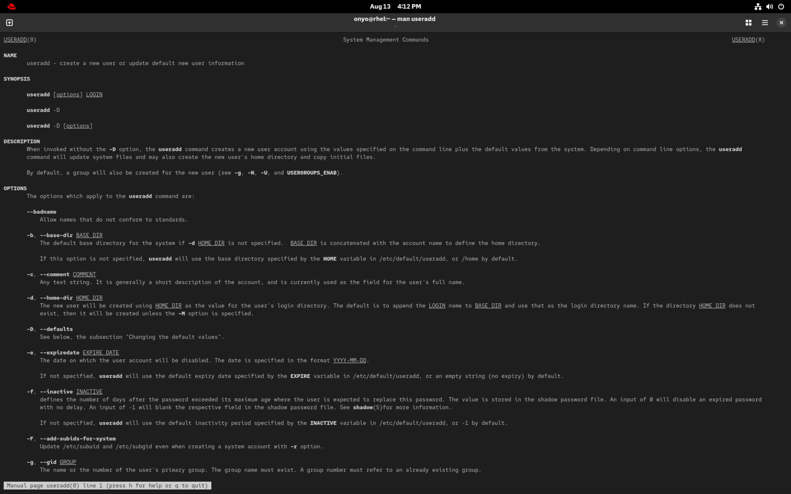
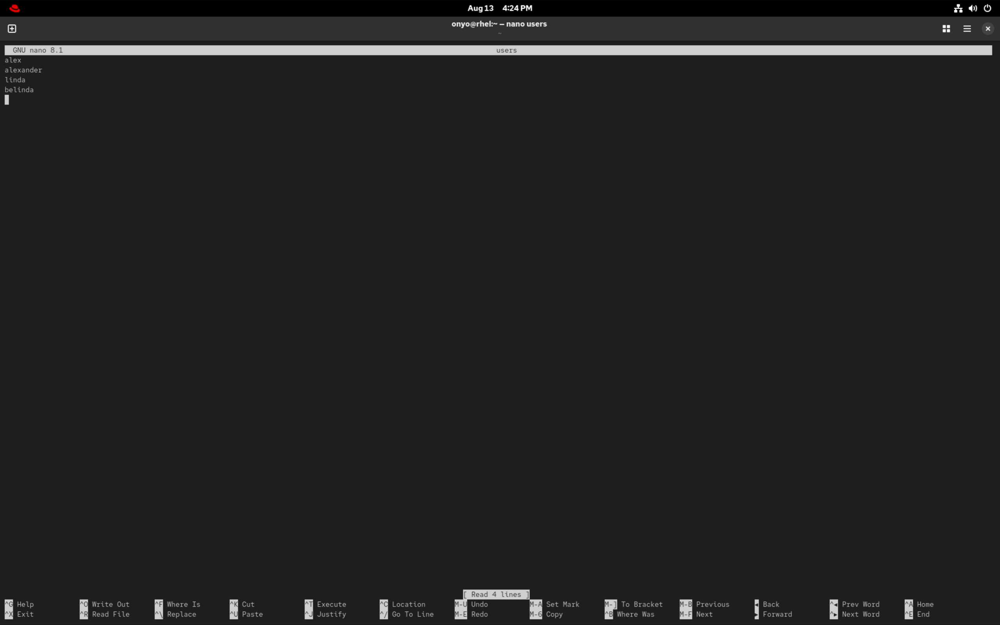

### Task: Lesson 4 Lab - Using Essential Tools

**Goal:** Use essential command-line tools to find manual pages, manage user accounts (create a user and set a password), and create/edit text files using a command-line text editor.

**Solution:**
1. Locate the manual page that shows how to set a password:
```bash
man -k password
```


2. Consult the `useradd` manual page to understand how to create a new user:
```bash
man useradd
```


3. Create the user `anna` and assign the requested password:
```bash
sudo useradd anna
sudo passwd anna
```


4. Use a text editor like `vim` or `nano` to create a file named `users` with the specified names:
```bash
nano users
```



