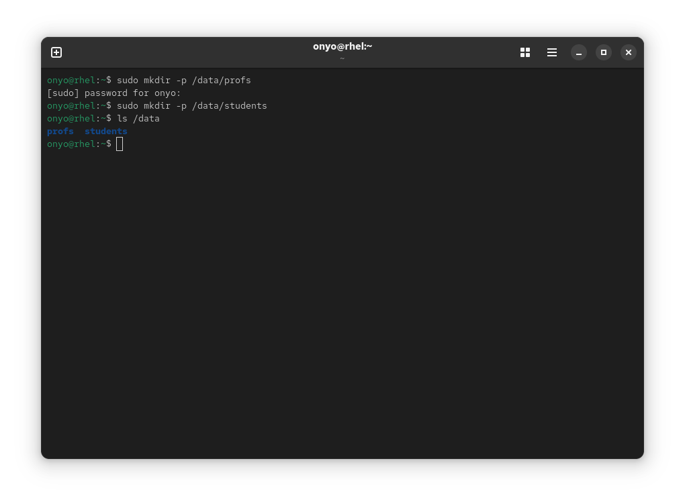
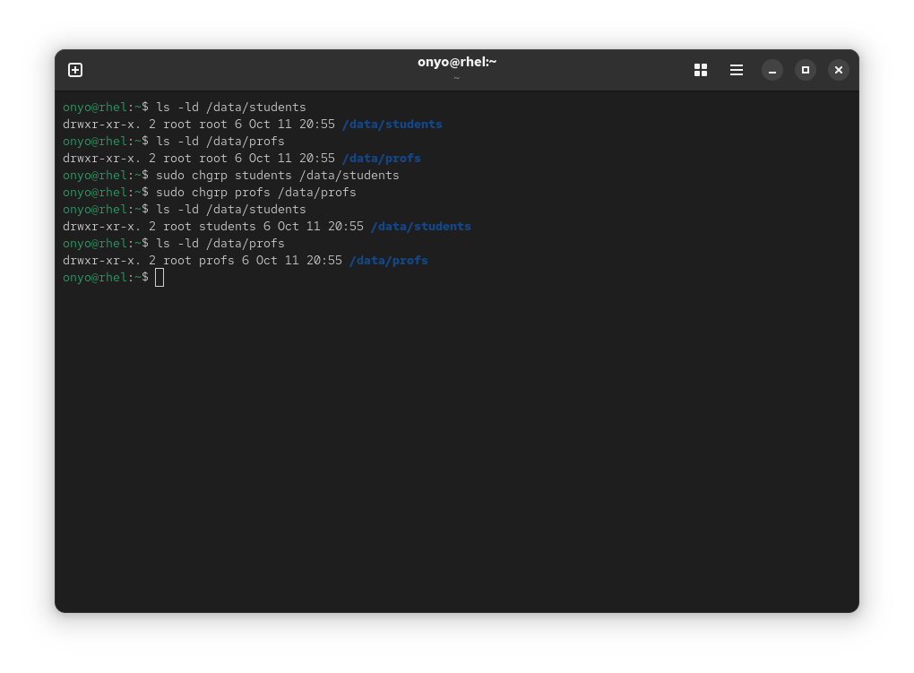
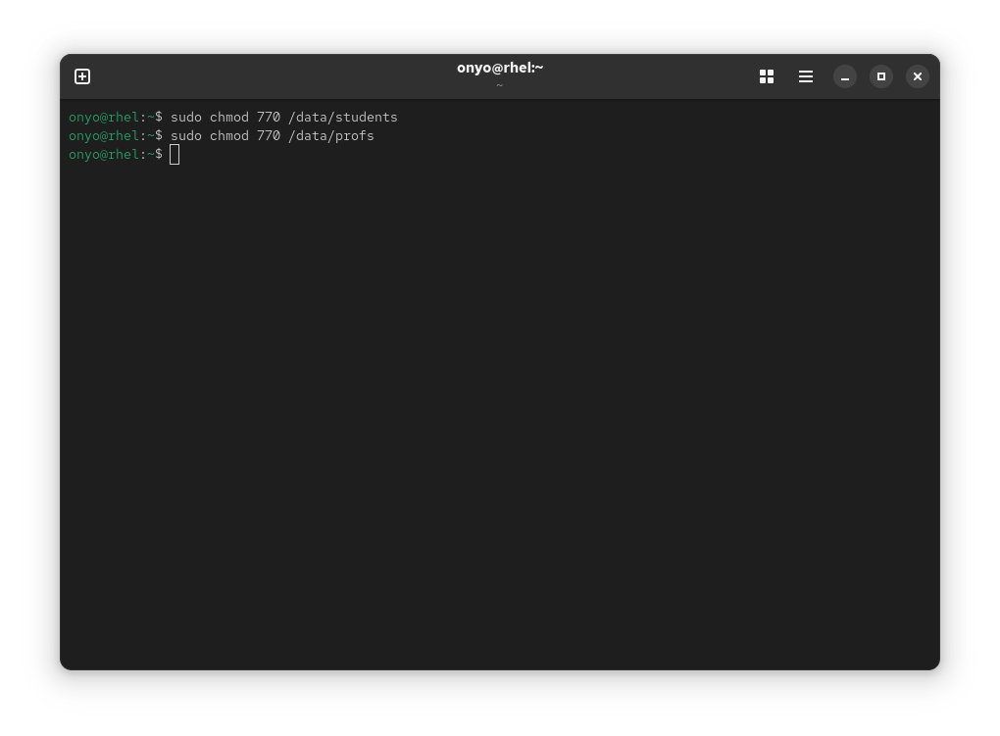
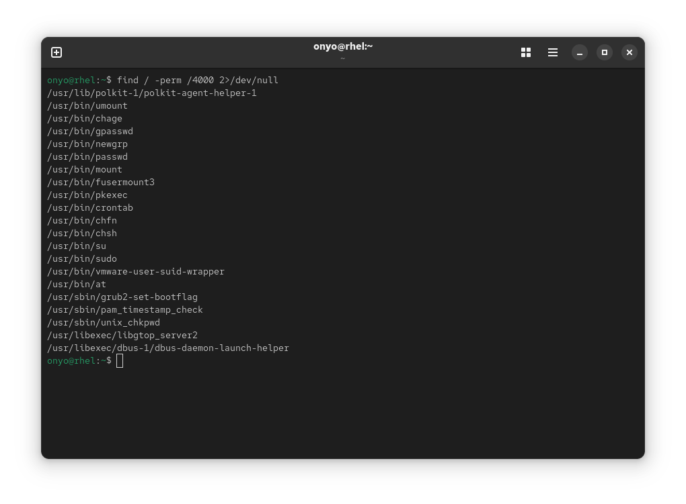

### Task: Lesson 10 Lab - Managing Permissions

**Goal:** Create shared group directories for `profs` and `students` under `/data`, grant each group full read/write access to their own directory while blocking all others, and find all files on the system with the SUID permission bit set.

**Solution:**

1. Create the shared group directories:
```bash
sudo mkdir -p /data/profs
sudo mkdir -p /data/students
ls /data
```
<p align="center">
  
</p>

2. Change the group ownership of each directory to its respective group:
```bash
sudo chgrp students /data/students
sudo chgrp profs /data/profs

ls -ld /data/students
ls -ld /data/profs
```
<p align="center">
  
</p>

3. Set permissions to `770` so the owning group has full read/write/execute access and others have no permissions at all:
```bash
sudo chmod 770 /data/students
sudo chmod 770 /data/profs
```
<p align="center">
  
</p>

4. Find all files on the system that have the SUID permission bit set:
```bash
find / -perm /4000 2>/dev/null
```
*(Errors are redirected to `/dev/null` to suppress warnings about inaccessible directories.)*
<p align="center">
  
</p>
