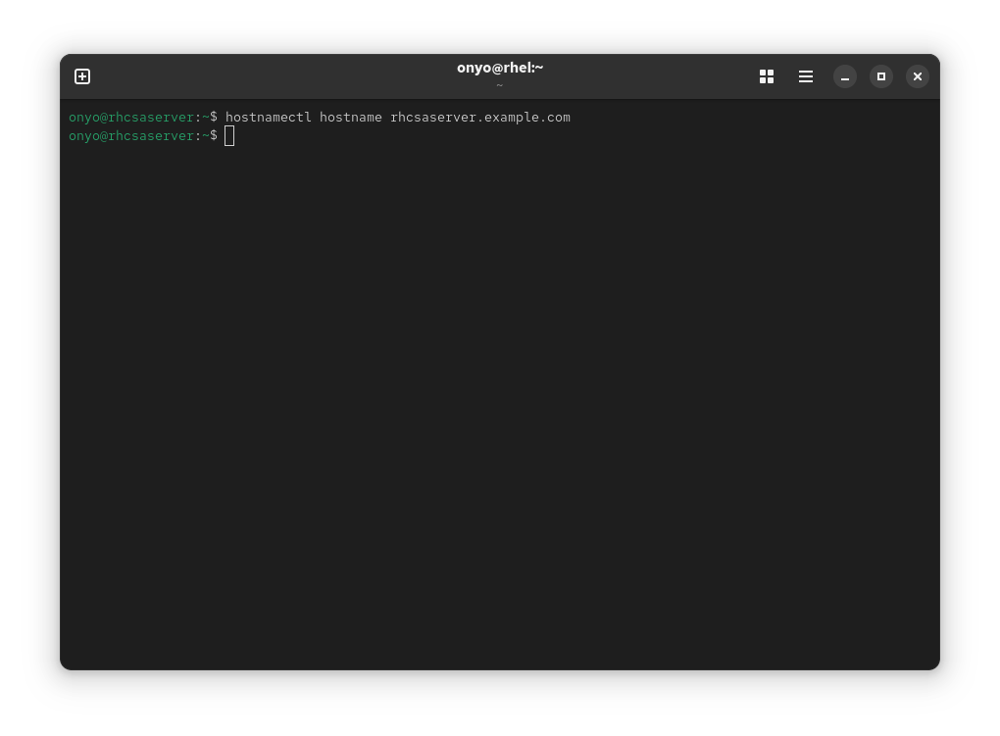
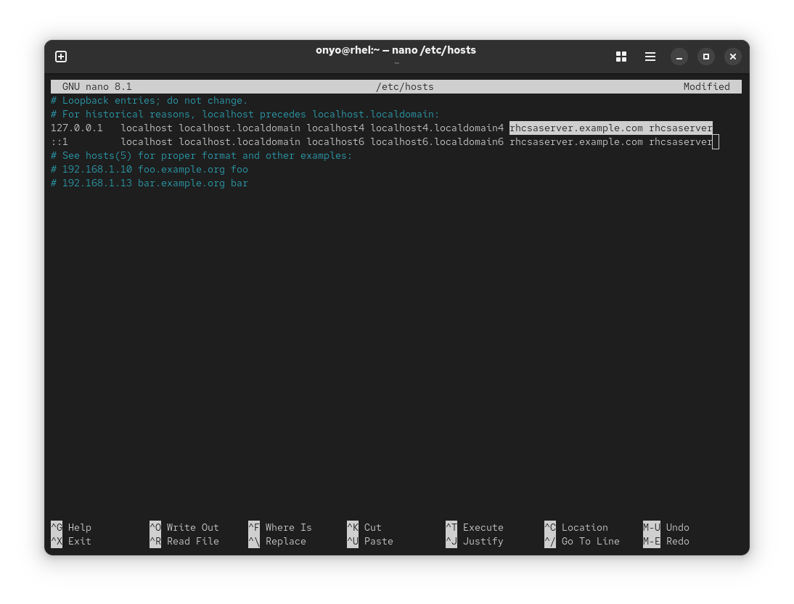
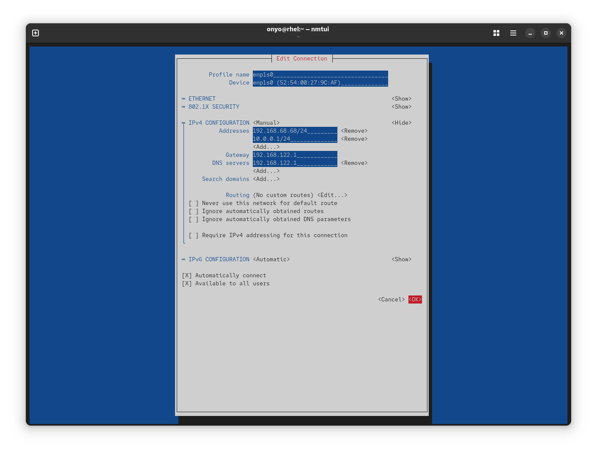
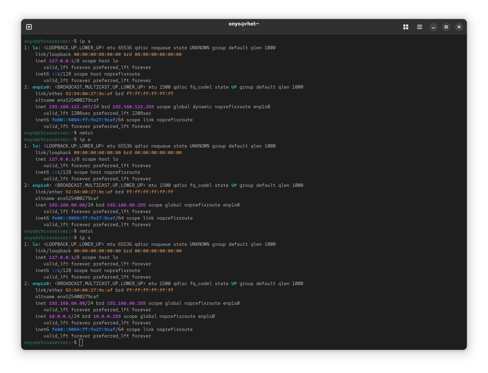

### Task: Lesson 11 Lab - Managing Network Configuration

**Goal:** Set a fully qualified hostname, assign two static IP addresses to the network interface, configure the gateway and DNS, and enable local hostname resolution. Then verify everything persists after reboot.

**Solution:**

1. Set the system hostname:
```bash
hostnamectl hostname rhcsaserver.example.com
```
<p align="center">
  
</p>

2. Enable local hostname resolution by adding entries for both IPv4 and IPv6 localhost in `/etc/hosts`:
```text
127.0.0.1   localhost localhost.localdomain localhost4 localhost4.localdomain4 rhcsaserver.example.com rhcsaserver
::1         localhost localhost.localdomain localhost6 localhost6.localdomain6 rhcsaserver.example.com rhcsaserver
```
<p align="center">
  
</p>

3. Open `nmtui` to configure the static IP addresses, gateway, and DNS on the network interface. Set both IP addresses, the gateway, and DNS server:
    - **IP addresses:** `192.168.68.68/24` and `10.0.0.1/24`
    - **Gateway:** `192.168.122.1`
    - **DNS:** `192.168.122.1`

```bash
nmtui
```
<p align="center">
  
</p>

4. Verify the new IP addresses are applied before and after the `nmtui` change:
```bash
ip a
```
<p align="center">
  
</p>
