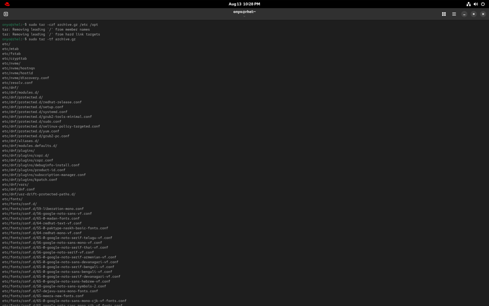
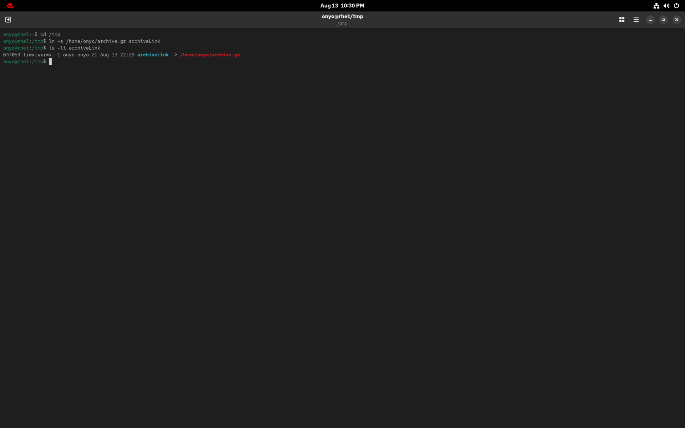
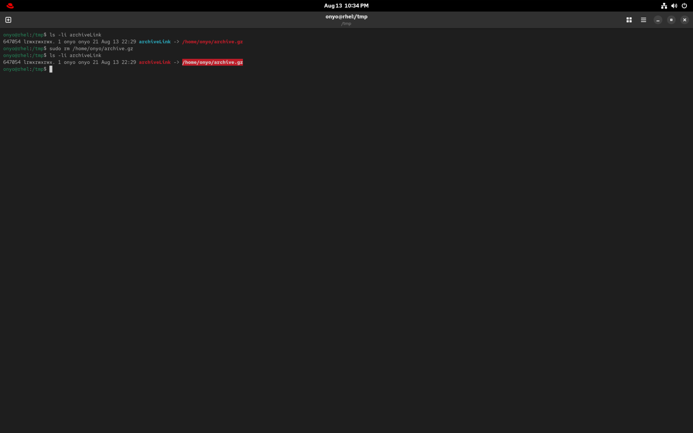

### Task: Lesson 6 Lab - Using Essential File Management Tools

**Goal:** Practice creating compressed archives using `tar`, managing symbolic links, and observing how symbolic links behave when their target file is removed.

**Solution:**
1. Create a compressed archive (gzip format) containing all files from the `/etc` and `/opt` directories, saving it directly to your home directory:
```bash
# Using sudo to ensure we have read access to all configuration files in /etc
sudo tar -czvf ~/system_backup.tar.gz /etc /opt
```


2. Create a symbolic (soft) link in the `/tmp` directory that points to the newly created archive in your home directory:
```bash
ln -s /home/onyo/archive.gz archiveLink
```


3. Remove the original archive from your home directory:
```bash
sudo rm /home/onyo/archive.gz
```
*Observation: After deletion, the symbolic link breaks (becomes a dangling link). This happens because a symbolic link simply stores the text path pointing to the original file; it does not store the data itself.*


