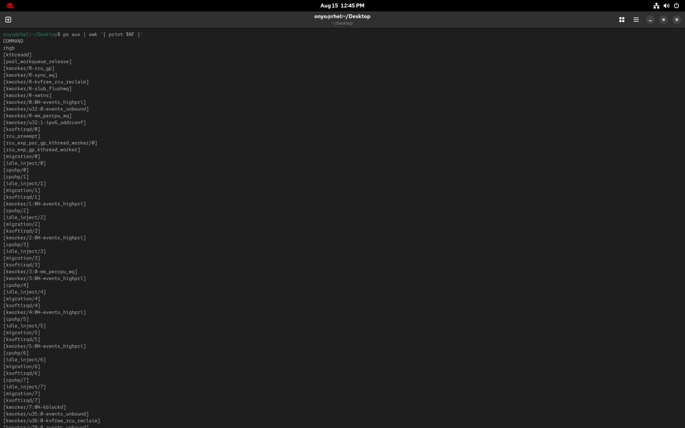
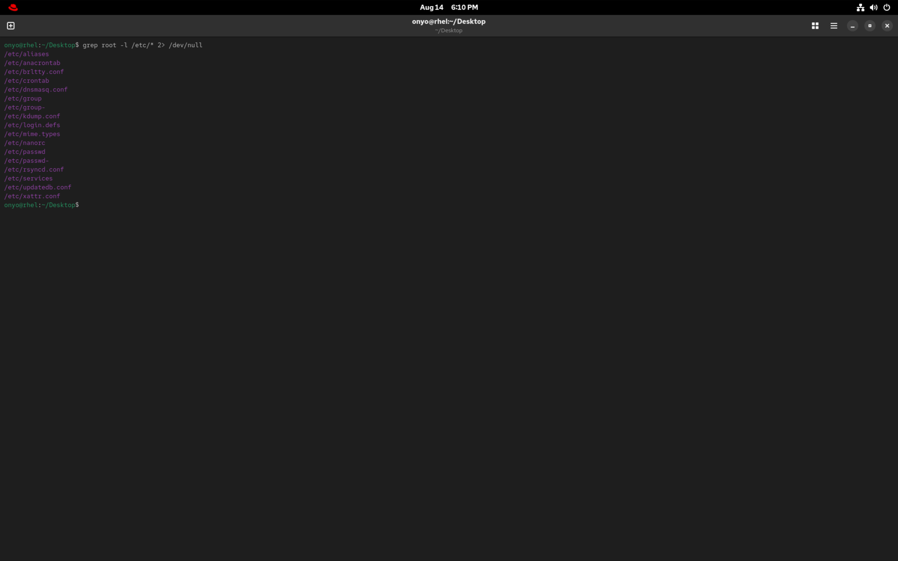
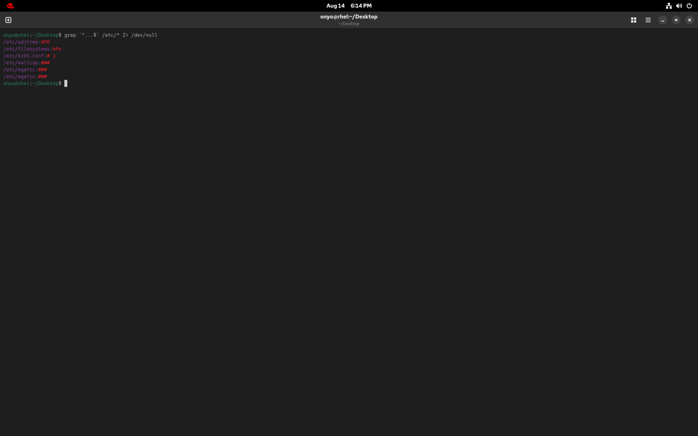
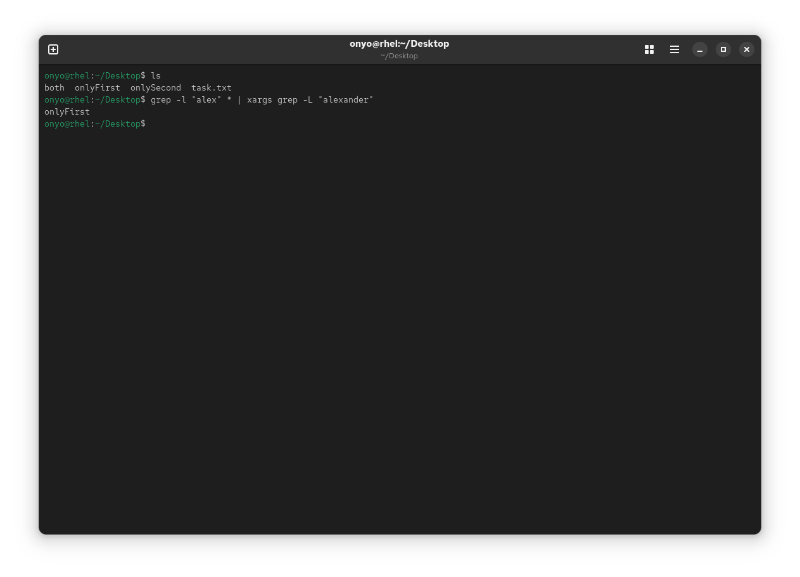

### Task: Lesson 7 Lab - Working with Text Files

**Goal:** Practice using essential text manipulation utilities (`head`, `tail`, `sed`, `awk`, and `grep`) to filter, extract, and search text in system files.

**Solution:**
1. Combine `head` and `tail` to display exactly the fifth line of the `/etc/passwd` file:
```bash
head -n 5 /etc/passwd | tail -n 1
```


2. Achieve the same result using `sed` to print only the fifth line:
```bash
sed -n 5p /etc/passwd
```


3. Use `awk` to extract and print only the final column (the command string) from the `ps aux` output:
```bash
ps aux | awk '{ print $NF }'
```


4. Use `grep` to list the names of all files in `/etc` that contain the word "root". 
*(Note: Errors are redirected to `/dev/null` to hide warnings about directories).*
```bash
grep -l root /etc/* 2> /dev/null
```


5. Use a `grep` regular expression to show all lines from files in `/etc` that contain exactly three characters:
```bash
grep '^...$' /etc/* 2> /dev/null
```


6. Find all files containing the string "alex" but explicitly exclude any files that contain "alexander":
*(Note: We use `grep -l` to output filenames containing "alex", and pipe that to `xargs` and `grep -L` to filter out files that also contain "alexander").*
```bash
grep -l "alex" * | xargs grep -L "alexander"
```
<p align="center">
  
</p>


