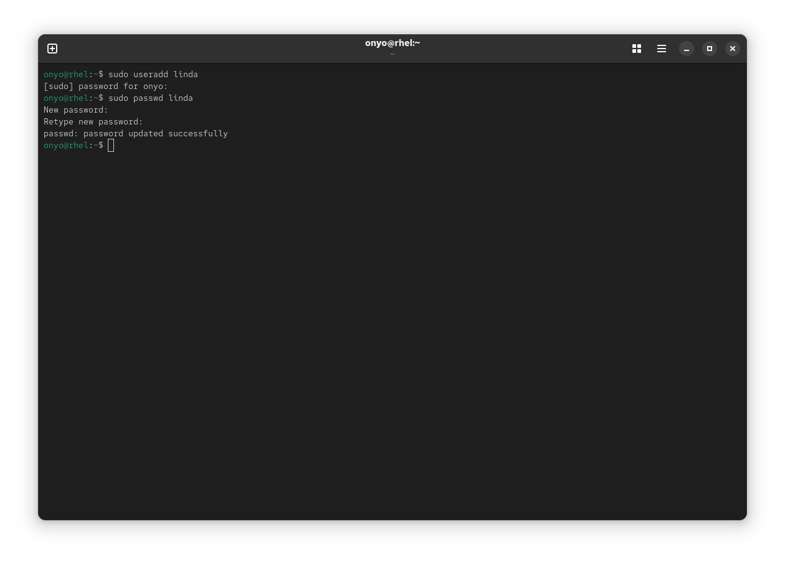
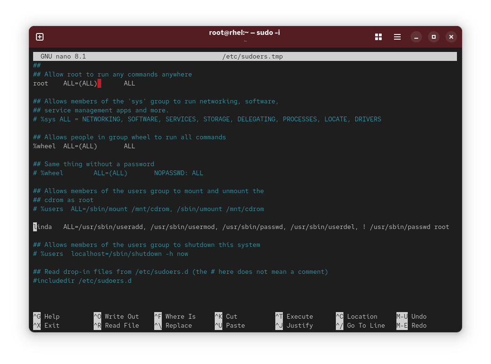
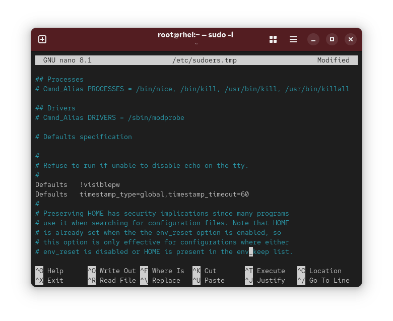

### Task: Lesson 8 Lab - Configuring sudo

**Goal:** Create a user `linda` and configure `sudo` to allow her to perform specific user management tasks, including changing passwords (but not root's), with a 60-minute sudo session timeout.

**Solution:**
1. Create the user `linda` and set her password:
```bash
sudo useradd linda
sudo passwd linda
```
<p align="center">
  
</p>

2. Open the sudoers file safely with `visudo` to allow `linda` to run specific user management commands, while explicitly denying her the ability to change the root password:
```bash
sudo visudo
```
Add the following line:
```text
linda   ALL=/usr/sbin/useradd, /usr/sbin/usermod, /usr/sbin/passwd, /usr/sbin/userdel, ! /usr/sbin/passwd root
```
*(The `!` prefix on `/usr/sbin/passwd root` explicitly denies linda from changing root's password.)*

<p align="center">
  
</p>

3. Still inside the sudoers file, add a `Defaults` entry to extend the sudo password timeout to 60 minutes so linda only needs to authenticate once per hour:
```text
Defaults    timestamp_type=global,timestamp_timeout=60
```
<p align="center">
  
</p>
