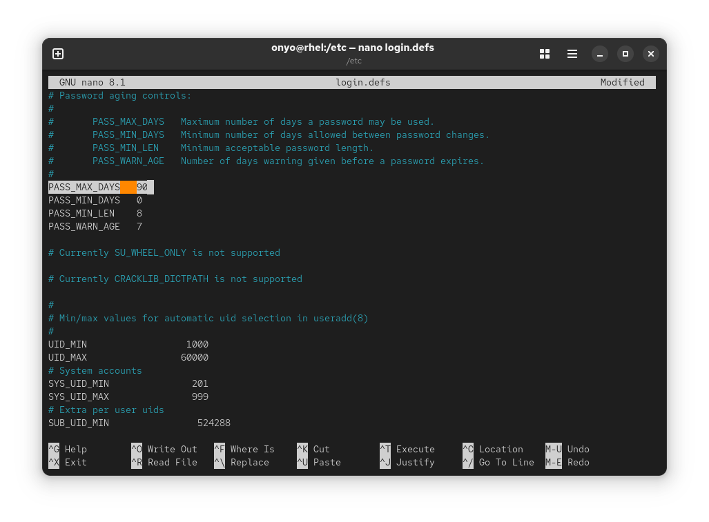
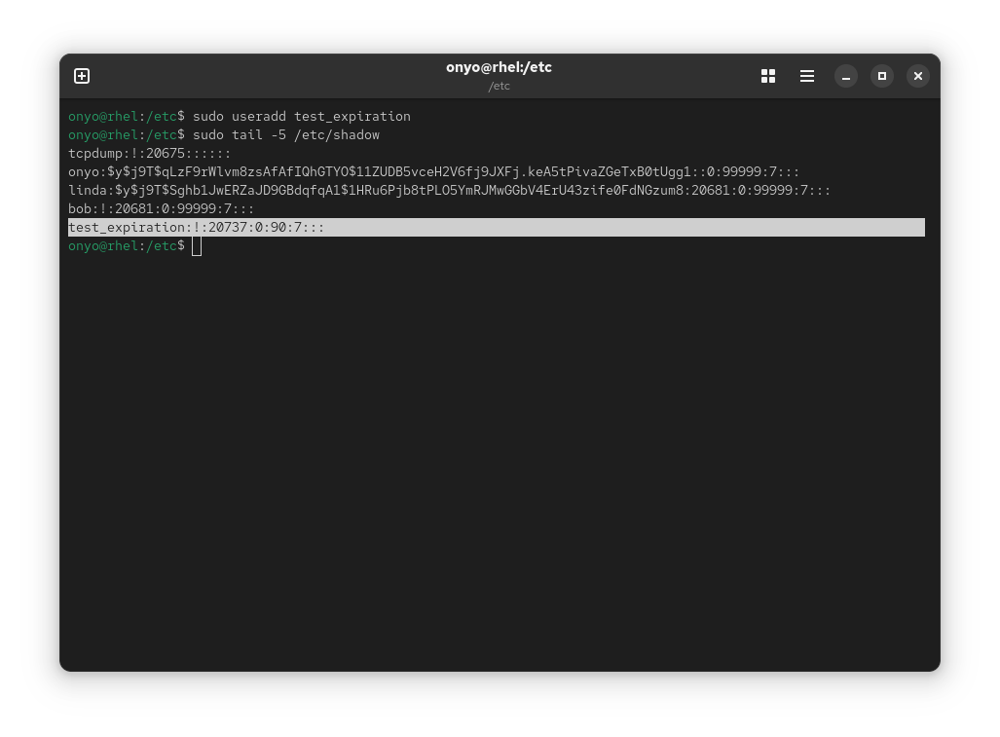
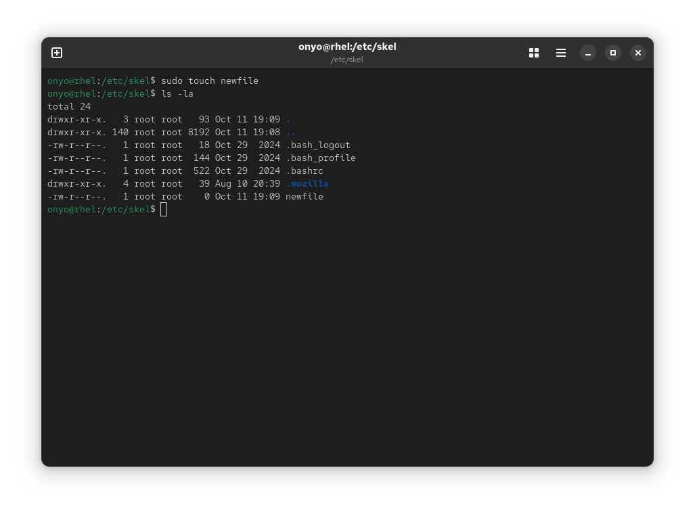
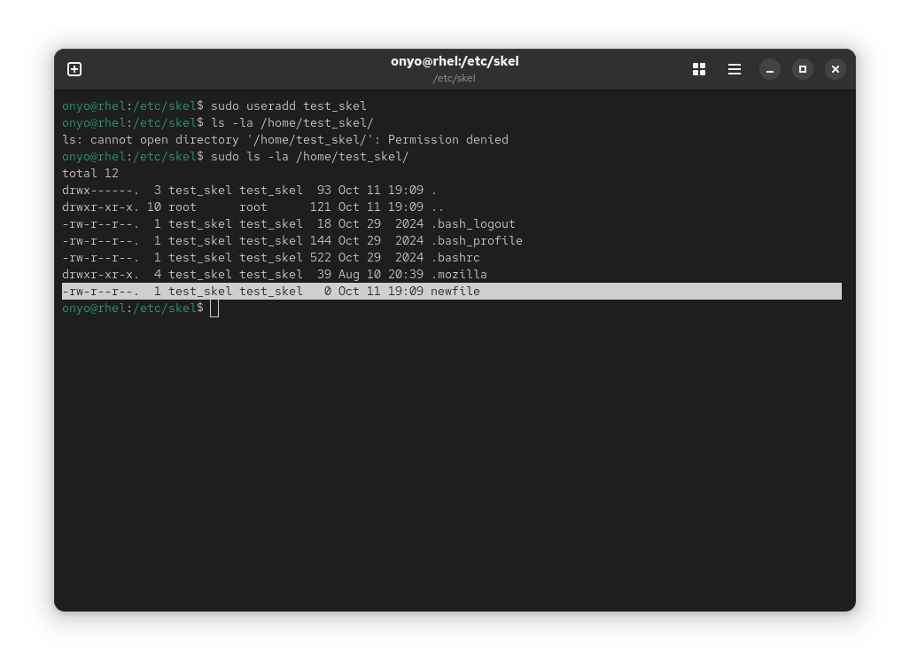
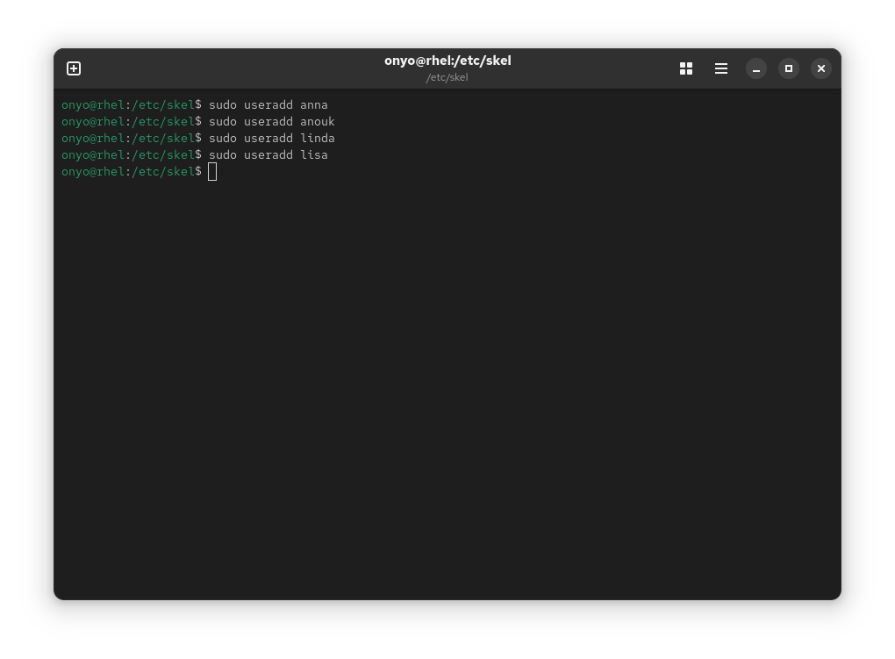
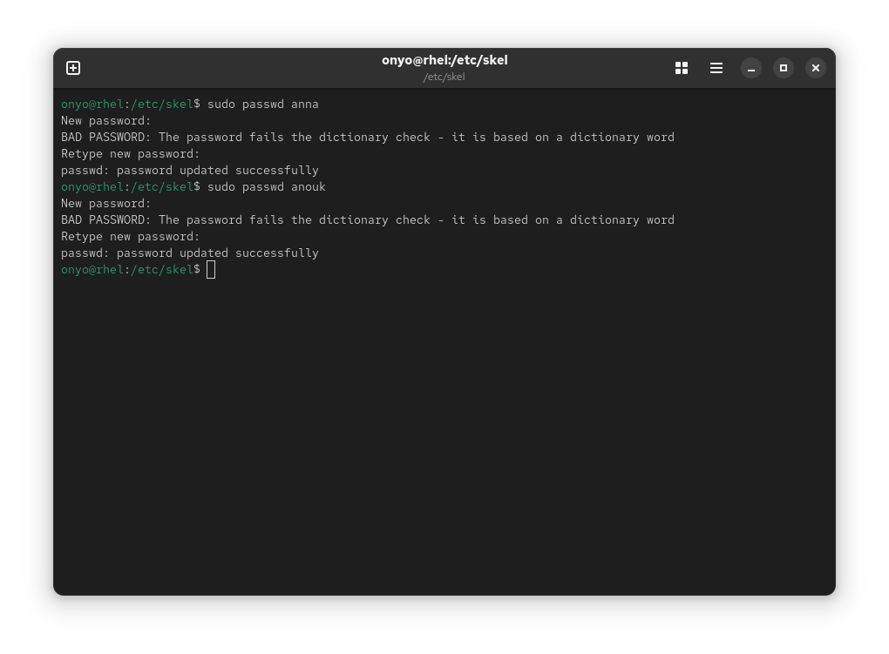
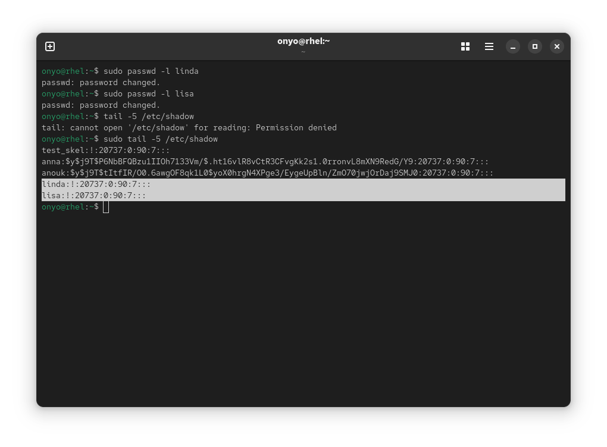
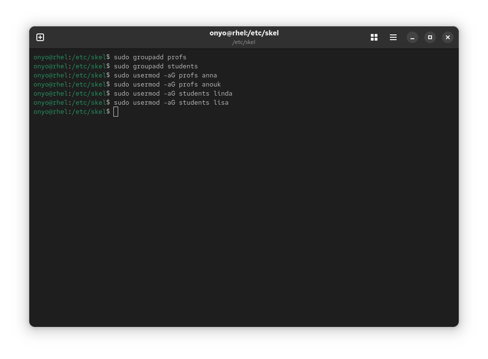
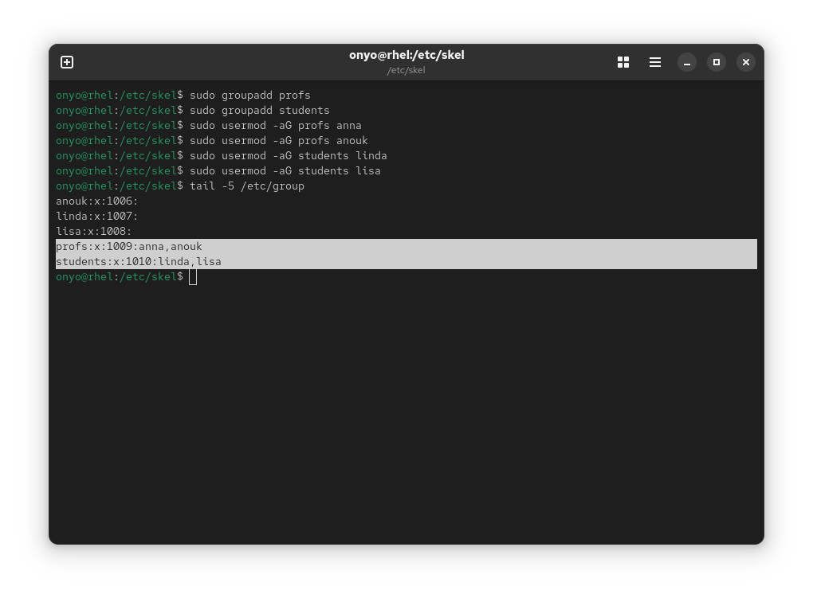

### Task: Lesson 9 Lab - Managing Users and Groups

**Goal:** Configure the system so new users get a 90-day max password validity, add a default `newfile` to the skeleton directory, create four users with appropriate passwords/locks, and organize them into `profs` and `students` groups.

**Solution:**

1. Set the maximum password validity to 90 days for all future users by editing `/etc/login.defs`:
```text
PASS_MAX_DAYS  90
```
<p align="center">
  
</p>

2. Verify the setting is picked up for newly created users by creating a test user and checking `/etc/shadow`:
```bash
sudo useradd test_expiration
sudo tail -5 /etc/shadow
```
<p align="center">
  
</p>

3. Add an empty `newfile` to the skeleton directory (`/etc/skel`) so every new user gets it automatically in their home folder:
```bash
sudo touch /etc/skel/newfile
ls -ls /etc/skel/
```
<p align="center">
  
</p>

4. Verify the skeleton is applied correctly by creating a test user and inspecting their home directory:
```bash
sudo useradd test_skel
sudo ls -la /home/test_skel/
```
<p align="center">
  
</p>

5. Create the four required users:
```bash
sudo useradd anna
sudo useradd anouk
sudo useradd linda
sudo useradd lisa
```
<p align="center">
  
</p>

6. Set passwords for `anna` and `anouk`:
```bash
sudo passwd anna
sudo passwd anouk
```
<p align="center">
  
</p>

7. Lock the accounts for `linda` and `lisa` (disabling their passwords), then verify in `/etc/shadow`:
```bash
sudo passwd -l linda
sudo passwd -l lisa

sudo tail -5 /etc/shadow
```
<p align="center">
  
</p>

8. Create the `profs` and `students` groups, then add the users to their respective groups:
```bash
sudo groupadd profs
sudo groupadd students
sudo usermod -aG profs anna
sudo usermod -aG profs anouk
sudo usermod -aG students linda
sudo usermod -aG students lisa
```
<p align="center">
  
</p>

9. Verify the group memberships:
```bash
tail -5 /etc/group
```
<p align="center">
  
</p>
