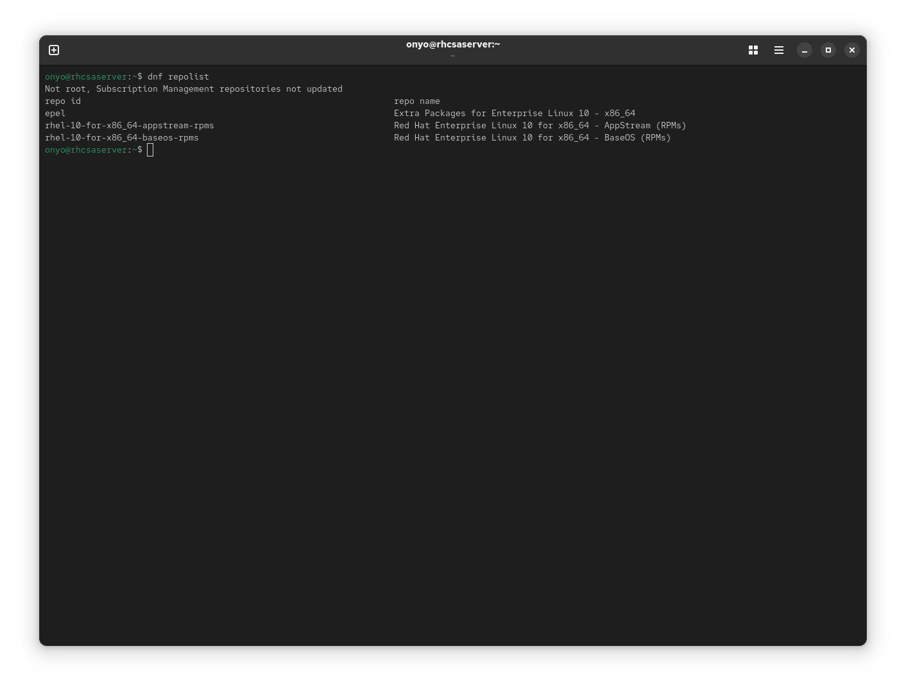
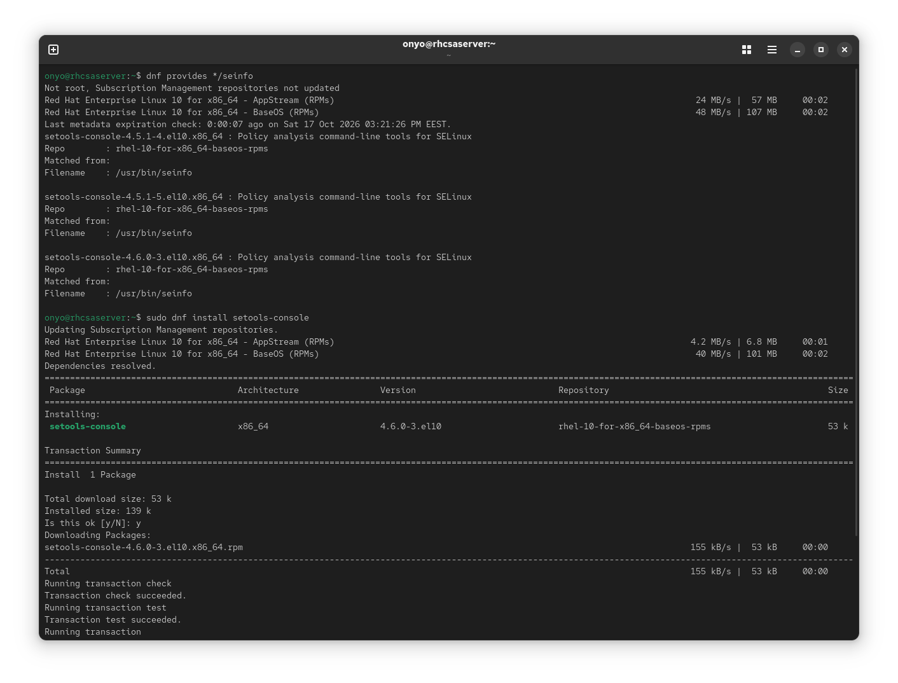
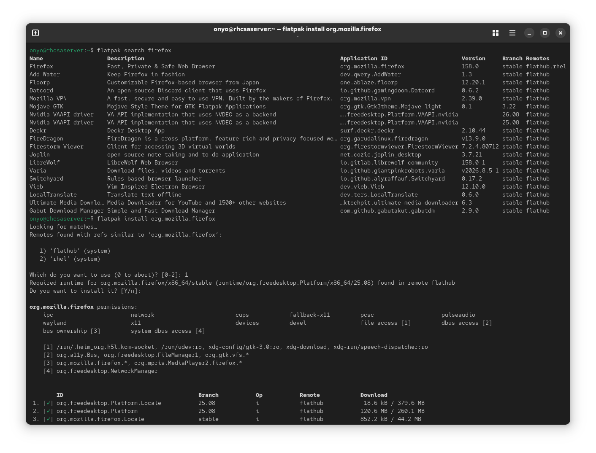

### Task: Lesson 12 Lab - Managing Software

**Goal:** Verify the system has the required DNF repositories configured, find and install the package that provides the `seinfo` utility, and install Firefox as a Flatpak application.

**Solution:**

1. Verify the system has the base packages and application streams repositories enabled:
```bash
dnf repolist
```
<p align="center">
  
</p>

2. Find which package provides the `seinfo` binary, then install it:
```bash
dnf provides */seinfo
sudo dnf install setools-console
```
<p align="center">
  
</p>

3. Search for Firefox on Flathub and install it as a Flatpak application:
```bash
flatpak search firefox
flatpak install flathub org.mozilla.firefox
```
<p align="center">
  
</p>
