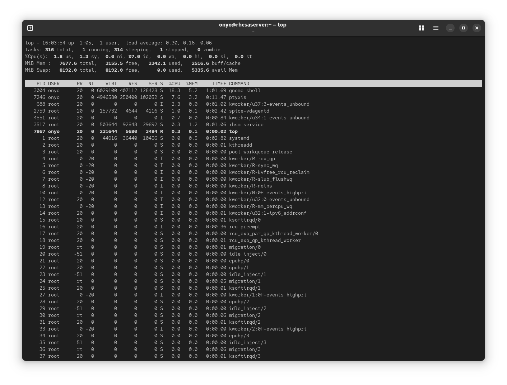
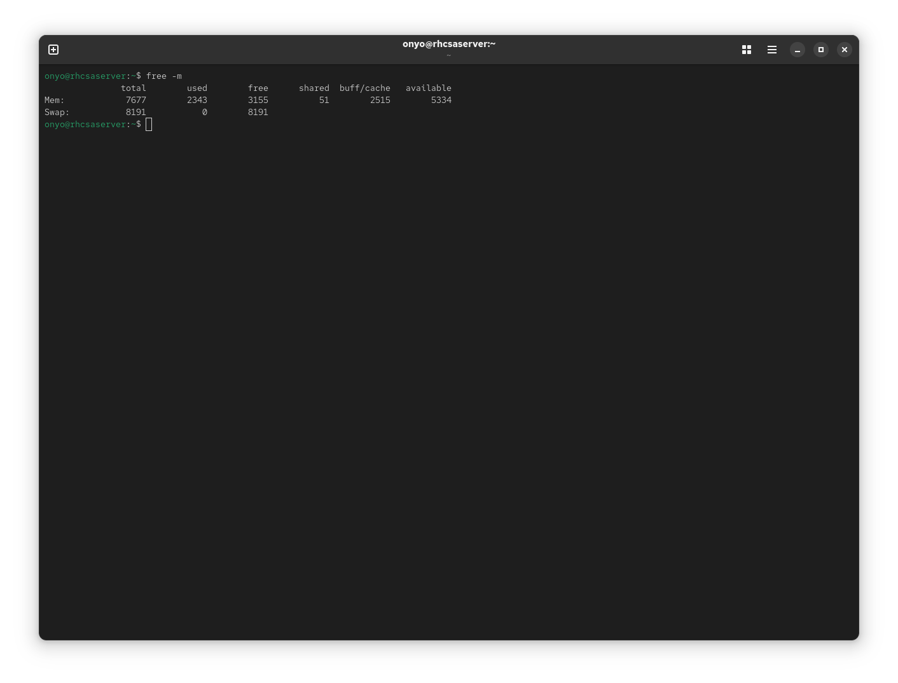
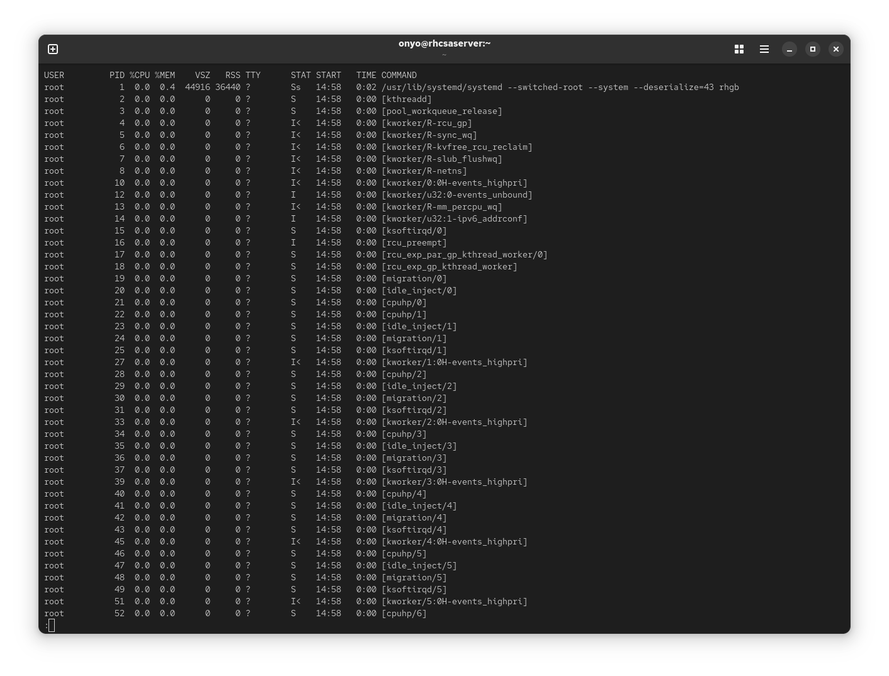
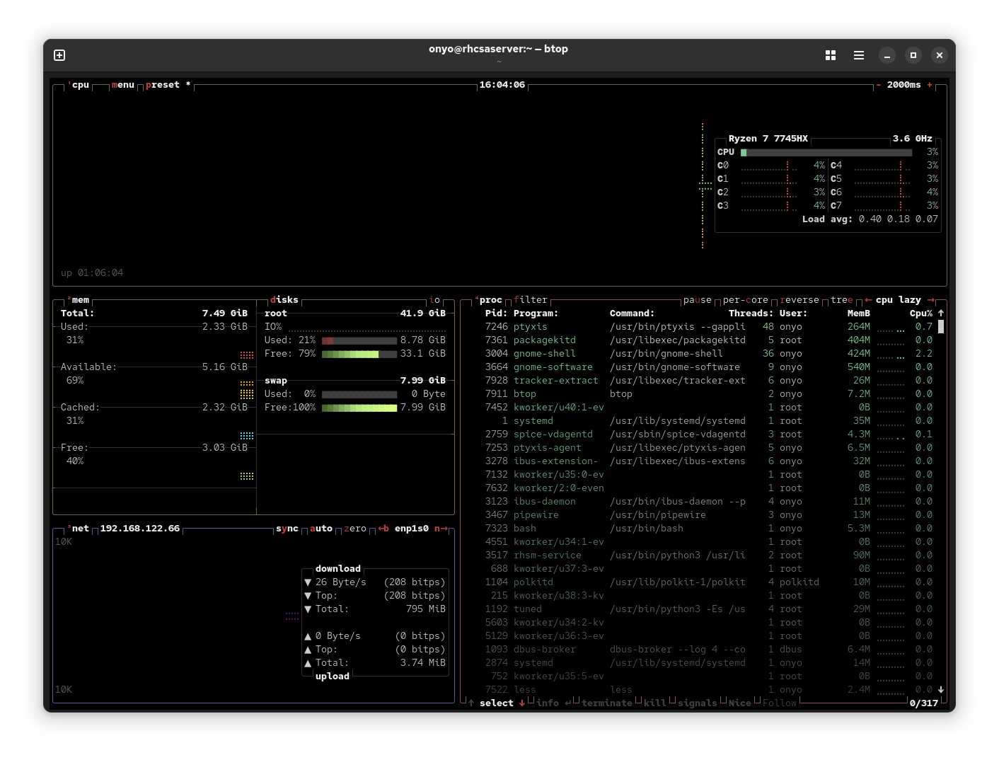

### Task: Lesson 13 Lab - Observing Processes

**Goal:** Use system monitoring utilities to evaluate whether machine performance is in good shape - checking CPU load, memory usage, running processes, and idle time.

**Solution:**

1. Use `top` to get a real-time overview of system performance. Key indicators to check:
    - **Load average** (1, 5, 15 min): `0.30, 0.16, 0.06` - all well below 1.0, meaning the CPU is not under stress
    - **Idle time**: `97%` - high idle percentage confirms the CPU has plenty of headroom
    - **Memory**: ~3 GiB free out of 8 GiB - healthy amount of available RAM
```bash
top
```
<p align="center">
  
</p>

2. Use `free -m` for a quick, readable summary of memory and swap usage in megabytes:
```bash
free -m
```
<p align="center">
  
</p>

3. Use `ps aux` to list all currently running processes with their CPU and memory consumption:
```bash
ps aux
```
<p align="center">
  
</p>

4. Optionally, `btop` is a modern, feature-rich alternative to `top` with a more visual interface:
```bash
btop
```
<p align="center">
  
</p>
