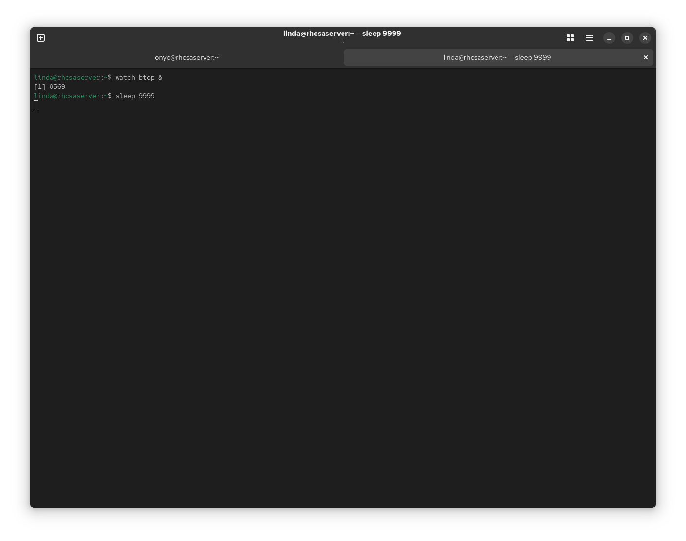
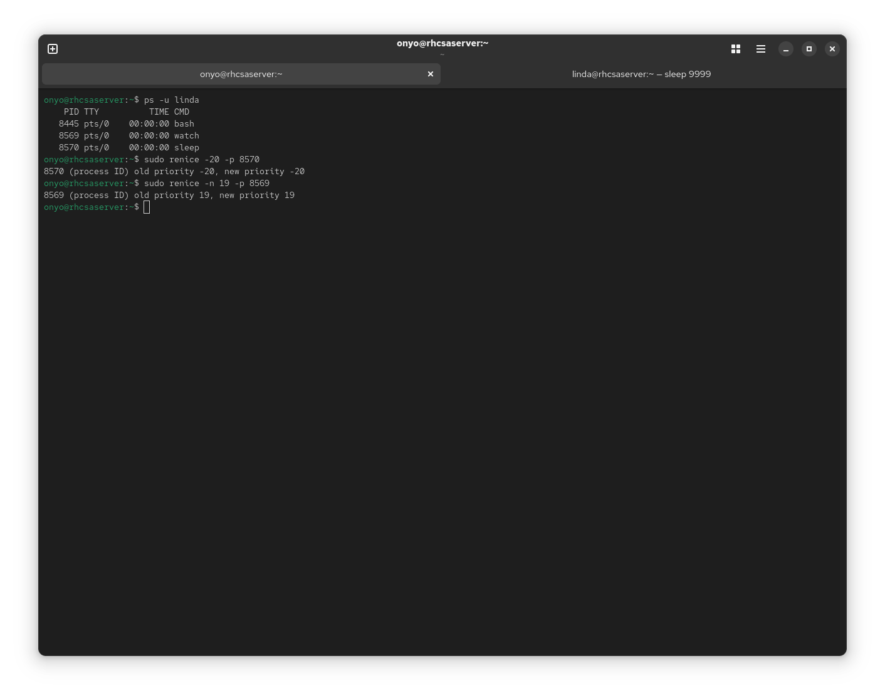
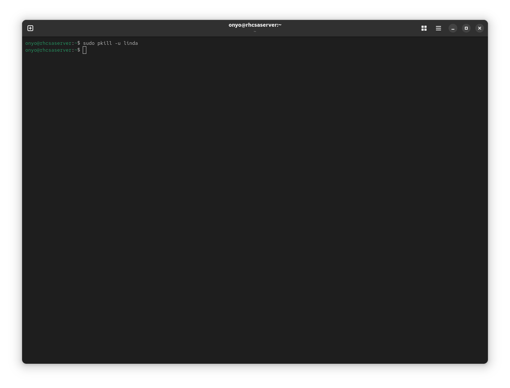

### Task: Lesson 14 Lab - Managing Processes

**Goal:** Run two background processes as user `linda` with opposite priorities (highest and lowest), then efficiently terminate all of linda's processes at once.

**Solution:**

1. Start two processes as `linda` - `watch btop` and `sleep 9999`:
```bash
watch btop &
sleep 9999
```
<p align="center">
  
</p>

2. Get the PIDs of linda's processes, then set their priorities using `renice`. Assign the highest priority (`-20`) to `sleep` and the lowest priority (`19`) to `btop`:
```bash
ps -u linda
sudo renice -20 -p 8570
sudo renice -n 19 -p 8569
```
<p align="center">
  
</p>

3. Use `pkill` to efficiently terminate all of linda's active sessions and processes at once:
```bash
sudo pkill -u linda
```
<p align="center">
  
</p>
