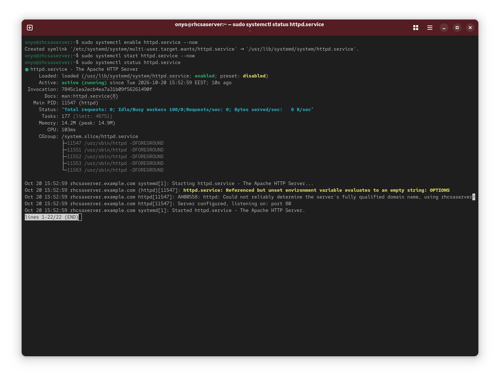
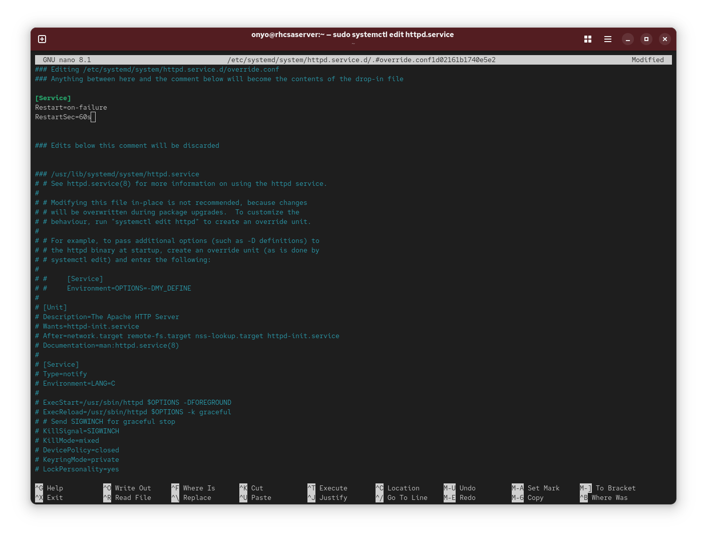

### Task: Lesson 15 Lab - Working with Systemd

**Goal:** Enable the `httpd` service to start automatically at boot, and configure it to automatically restart after a 60-second delay if it ever fails.

**Solution:**

1. Enable `httpd` to start at boot and start it immediately, then verify it is running:
```bash
sudo systemctl enable httpd.service --now
sudo systemctl start httpd.service --now
sudo systemctl status httpd.service
```
<p align="center">
  
</p>

2. Edit the `httpd` service unit to add automatic restart-on-failure behavior with a 60-second delay:
```bash
sudo systemctl edit httpd.service
```
Add the following override configuration:
```text
[Service]
Restart=on-failure
RestartSec=60s
```

<p align="center">
  
</p>
