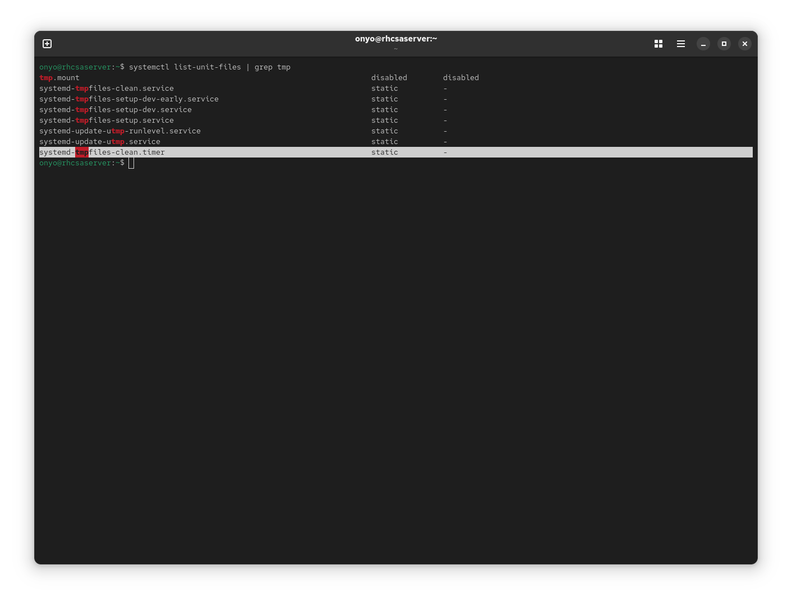
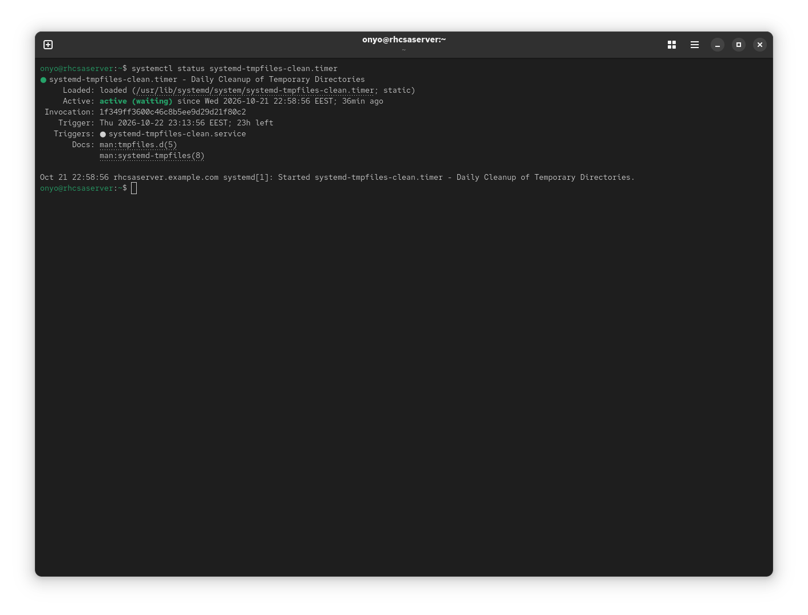
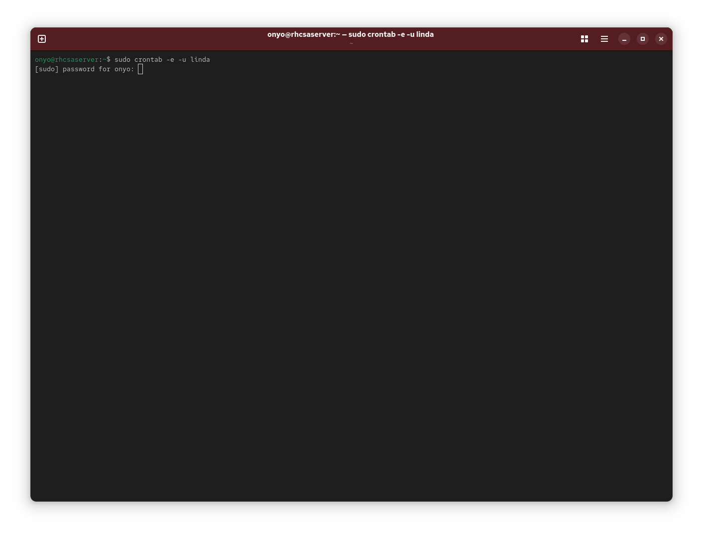
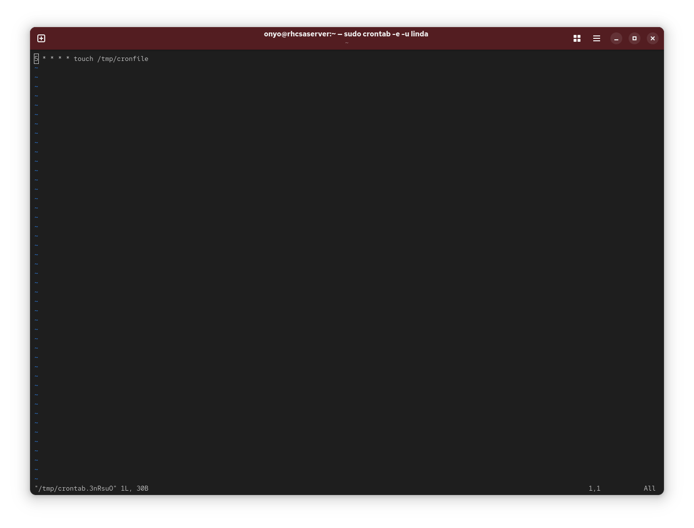
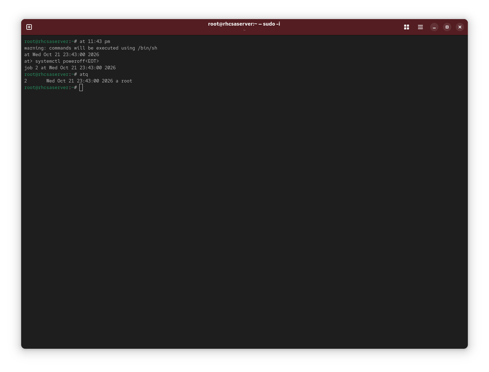

### Task: Lesson 16 Lab - Scheduling Tasks

**Goal:** Verify the systemd tmp-cleanup timer is active, schedule a one-off `poweroff` with `at`, and set up a cron job for user `linda` that creates `/tmp/cronfile` every hour at 5 minutes past.

**Solution:**

1. Find the systemd timer responsible for cleaning up tmp files:
```bash
systemctl list-unit-files | grep tmp
```
<p align="center">
  
</p>

2. Check the status of the timer to confirm it is active and enabled:
```bash
systemctl status systemd-tmpfiles-clean.timer
```
<p align="center">
  
</p>

3. Open linda's crontab to add a scheduled job:
```bash
sudo crontab -e -u linda
```
<p align="center">
  
</p>

4. Add the following cron job to run `touch /tmp/cronfile` at 5 minutes past every hour:
```text
5 * * * * touch /tmp/cronfile
```
<p align="center">
  
</p>

5. Use `at` to schedule a one-off system poweroff at a specific time, then verify the job is queued with `atq`:
```bash
at 11:43 PM
```
At the `at` prompt, type:
```text
systemctl poweroff
```
Then confirm the job is queued:
```bash
atq
```
<p align="center">
  
</p>
