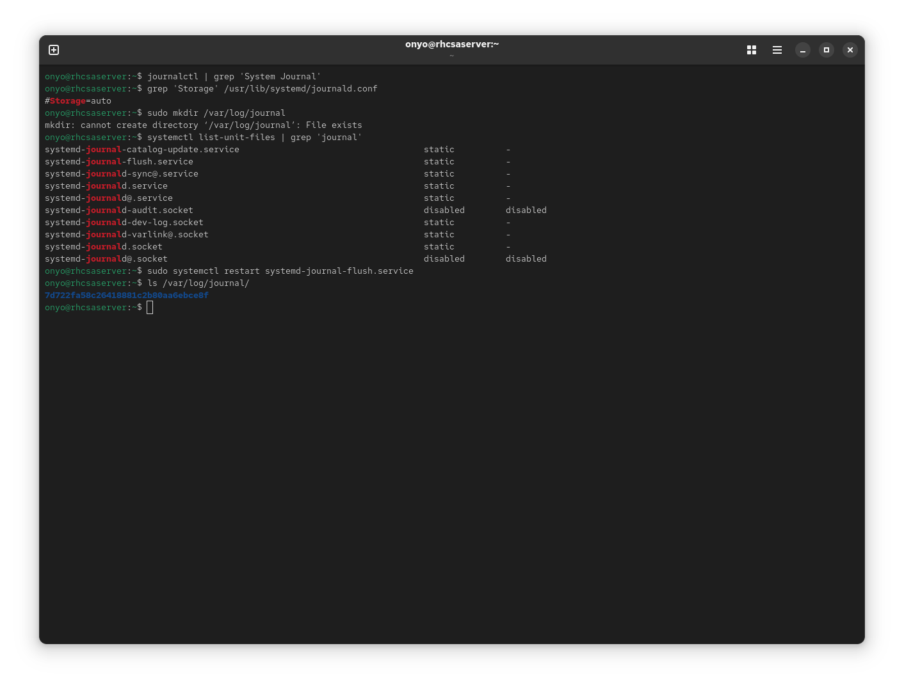
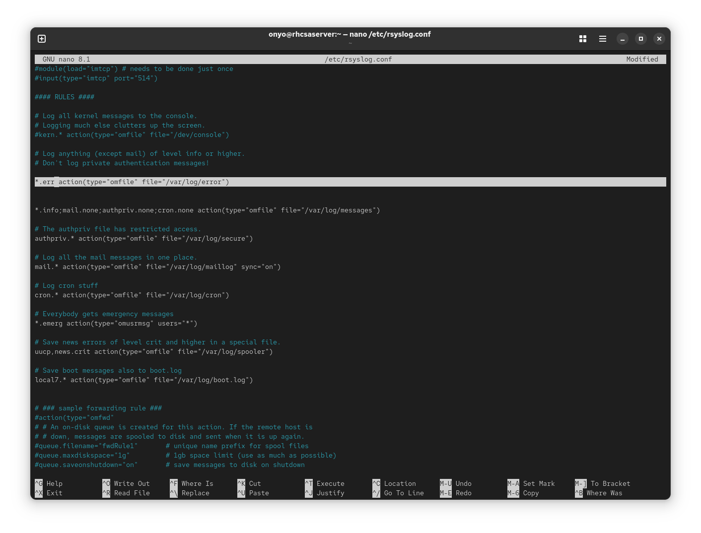
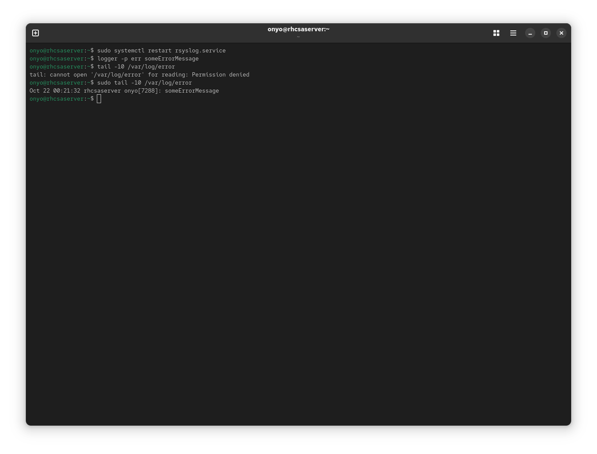
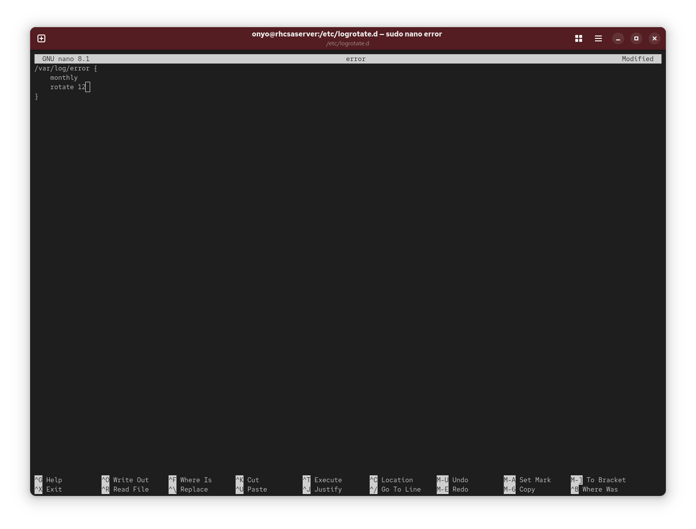

### Task: Lesson 17 Lab - Configuring Logging

**Goal:** Make the systemd journal persistent across reboots, configure rsyslog to write all error-level messages to `/var/log/error`, and set up log rotation to keep 12 monthly archives of that file.

**Solution:**

1. Make the systemd journal persistent by creating the journal directory, then restart the flush service to apply it:
```bash
sudo mkdir /var/log/journal
systemctl list-unit-files | grep 'journal'
sudo systemctl restart systemd-journal-flush.service
ls /var/log/journal
```
*(Creating `/var/log/journal` is all that is needed - systemd detects it and begins writing persistent logs there automatically.)*
<p align="center">
  
</p>

2. Add a rule to `/etc/rsyslog.conf` to capture all messages at `err` severity or higher and write them to `/var/log/error`:
```text
*.err action(type="omfile" file="/var/log/error")
```
<p align="center">
  
</p>

3. Restart `rsyslog` to apply the new rule, then test it by sending a manual error message and confirming it appears in the log:
```bash
sudo systemctl restart rsyslog.service

logger -p err someErrorMessage

sudo tail -10 /var/log/error
```
<p align="center">
  
</p>

4. Create a logrotate configuration for `/var/log/error` to rotate it monthly and retain the last 12 archives. Add the following to `/etc/logrotate.d/error`:
```text
/var/log/error {
    monthly
    rotate 12
}
```
<p align="center">
  
</p>
