### Task: Lesson 18 Lab - Managing Partitions

**Goal:** Add a new 10 GiB virtual disk, create a 1 GiB Ext4 partition mounted persistently on `/mount/files` via UUID, and create a 512 MiB swap partition mounted persistently.

**Solution:**

1. Add a new 10 GiB virtual disk to the virtual machine from the hypervisor settings, then verify it is visible to the OS:
```bash
lsblk
```
<p align="center">
  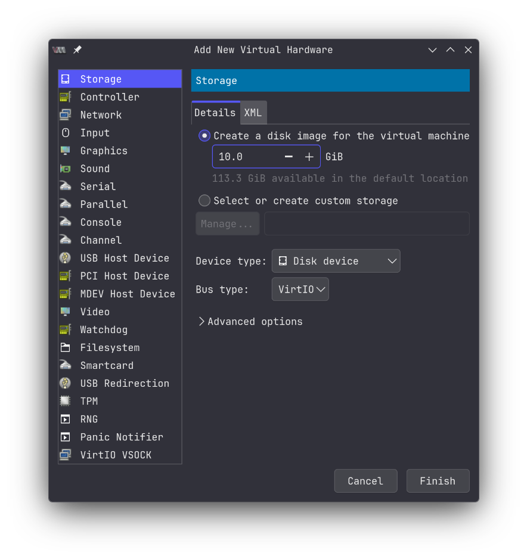
</p>

<p align="center">
  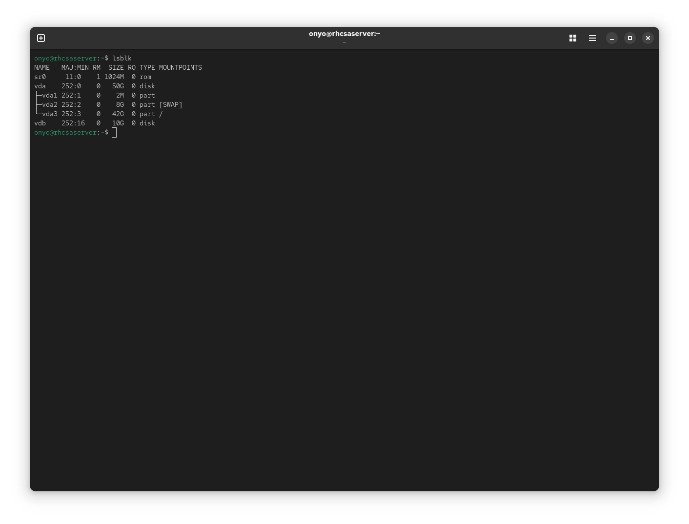
</p>

2. Use `fdisk` to create a new GPT partition table and add a 1 GiB partition on the new disk:
```bash
sudo fdisk /dev/vdb
```
Inside `fdisk`:
```text
g   # create new GPT partition table
n   # add new partition, size +1G
p   # print partition table to verify
w   # write changes and exit
```
<p align="center">
  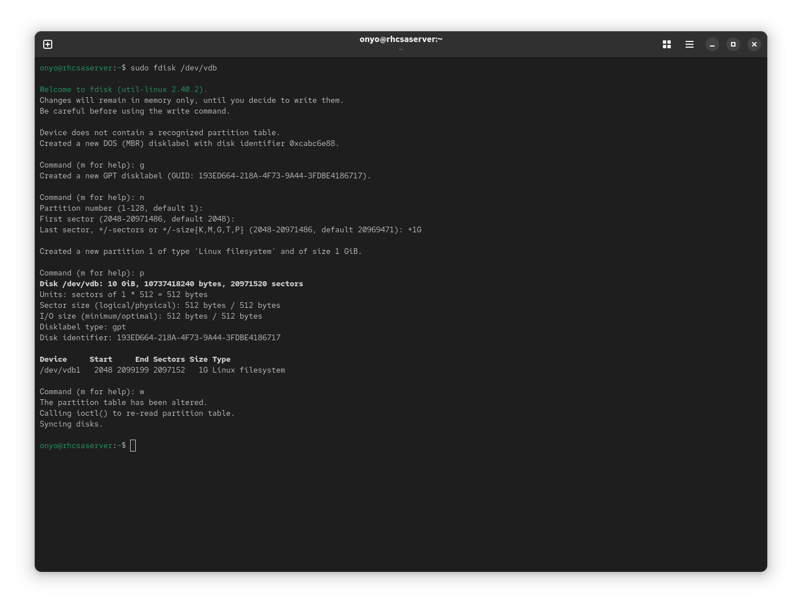
</p>

3. Format the new partition with the Ext4 filesystem:
```bash
sudo mkfs.ext4 /dev/vdb1
```
<p align="center">
  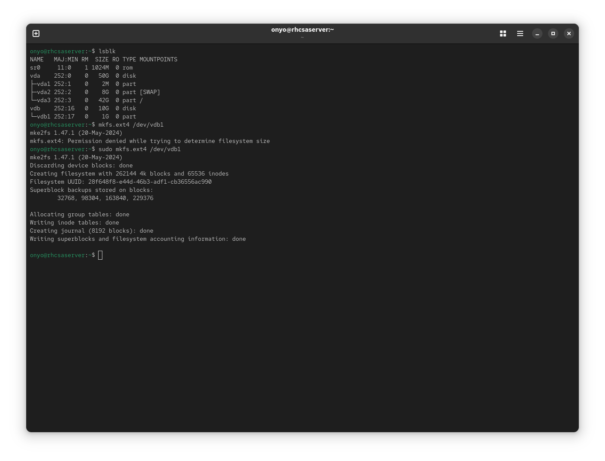
</p>

4. Create the mount point, mount the partition, and confirm with `lsblk`:
```bash
sudo mkdir -p /mount/files
sudo mount /dev/vdb1 /mount/files
lsblk -f
```
<p align="center">
  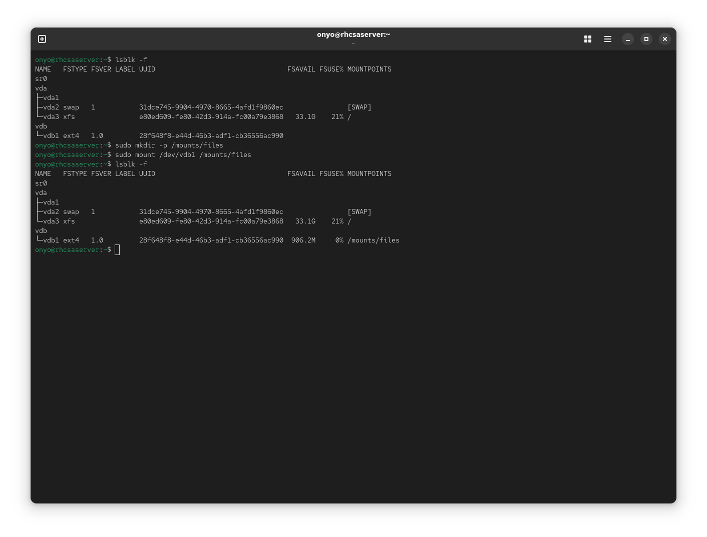
</p>

5. Get the UUID of the partition to use for persistent mounting:
```bash
lsblk -f
```
<p align="center">
  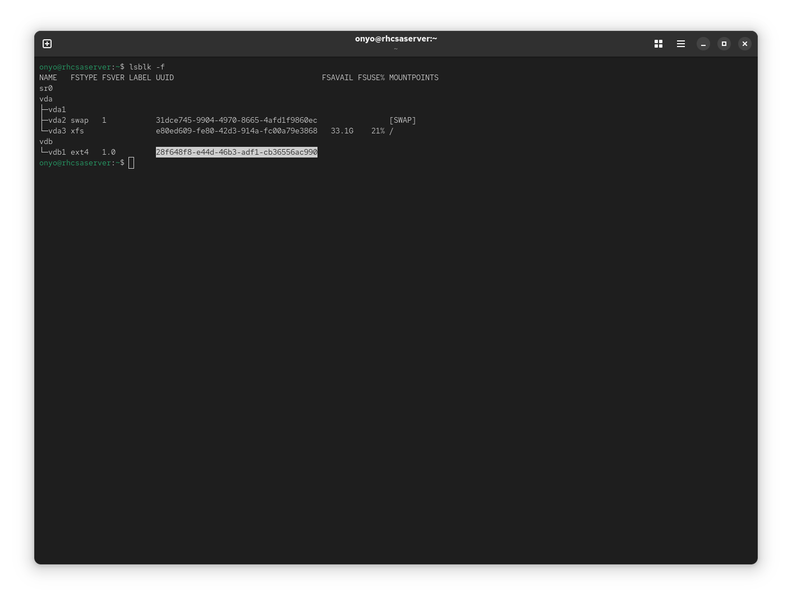
</p>

6. Add the partition to `/etc/fstab` for persistent mounting using its UUID:
```text
UUID=<partition_uuid>   /mount/files    ext4    defaults    0 0
```
<p align="center">
  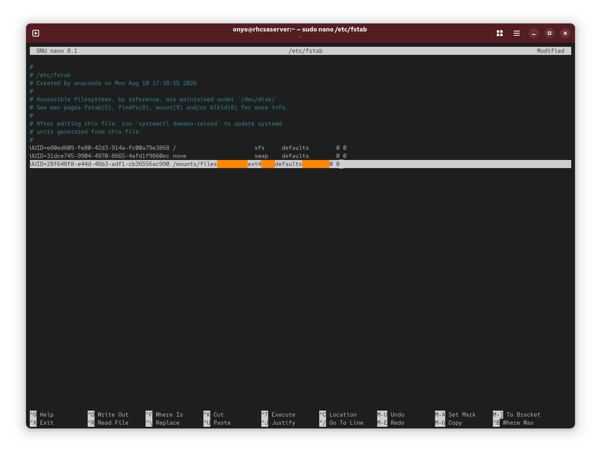
</p>

7. Use `fdisk` again to add a 512 MiB swap partition on the same disk:
```bash
lsblk -f
sudo fdisk /dev/vdb
```
Inside `fdisk`:
```text
n   # add new partition, size +512M
t   # change type to swap (Linux swap)
p   # print partition table to verify
w   # write changes and exit
```
<p align="center">
  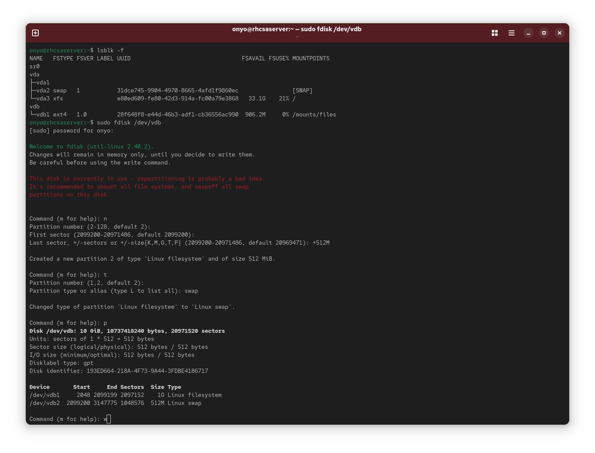
</p>

8. Format the partition as swap:
```bash
sudo mkswap /dev/vdb2
```
<p align="center">
  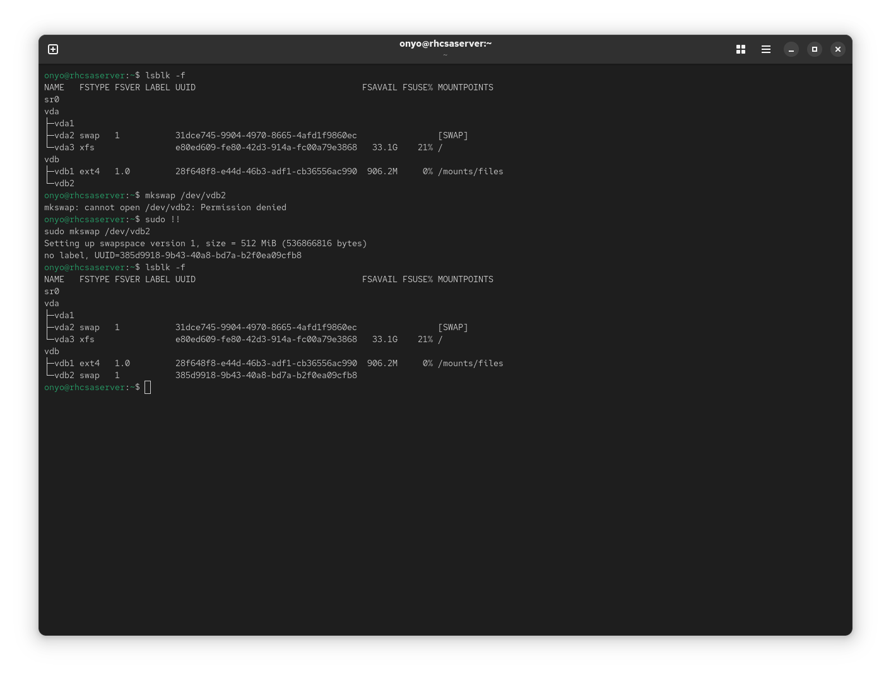
</p>

9. Add the swap partition to `/etc/fstab` for persistent activation using its UUID:
```text
UUID=<partition_uuid>   none    swap    defaults    0 0
```
<p align="center">
  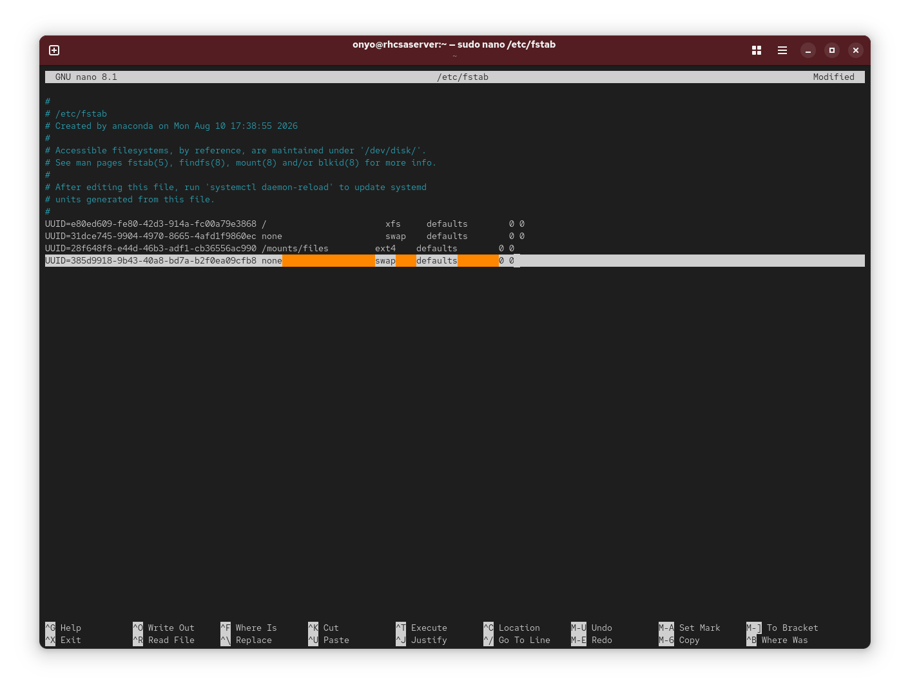
</p>

10. Activate all swap entries from `/etc/fstab` and verify both the swap and Ext4 partition are active:
```bash
sudo swapon -a
lsblk -f
free -h
```
<p align="center">
  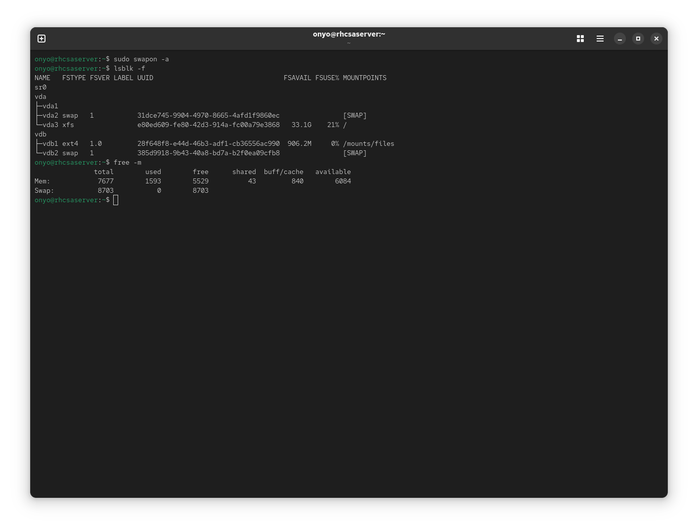
</p>
