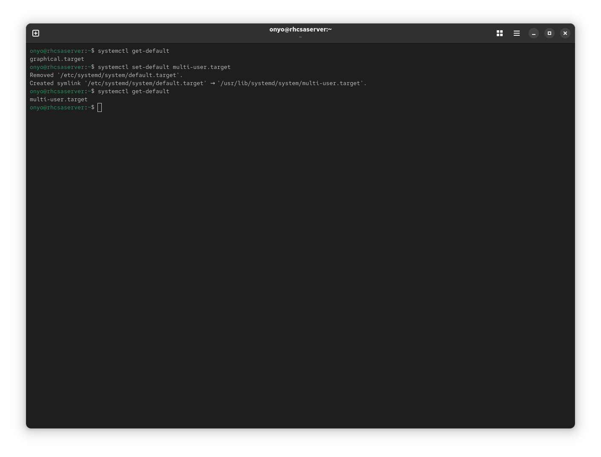
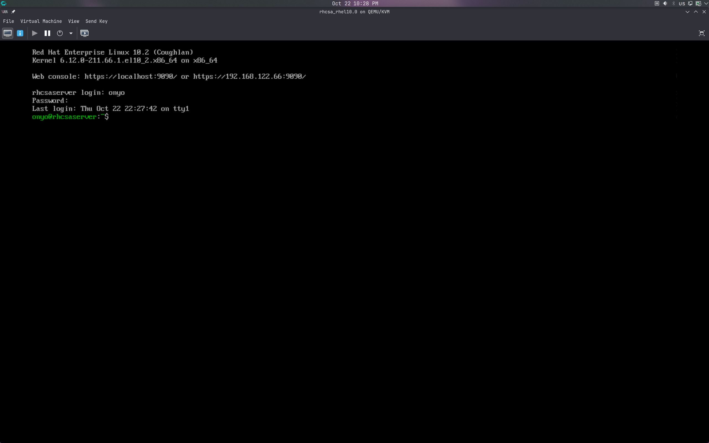
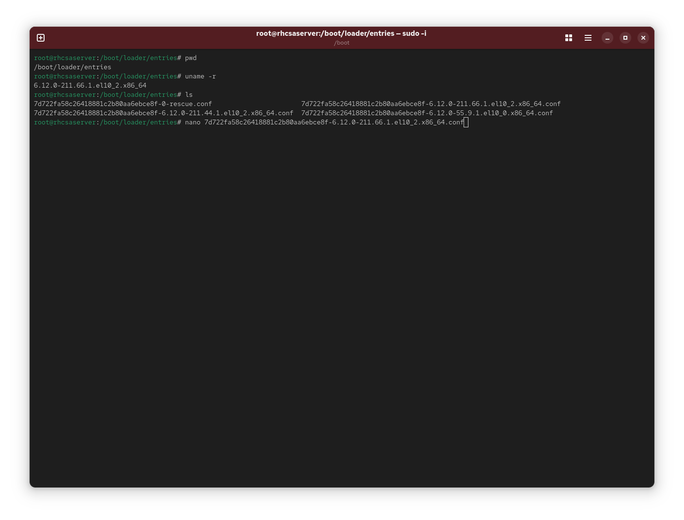
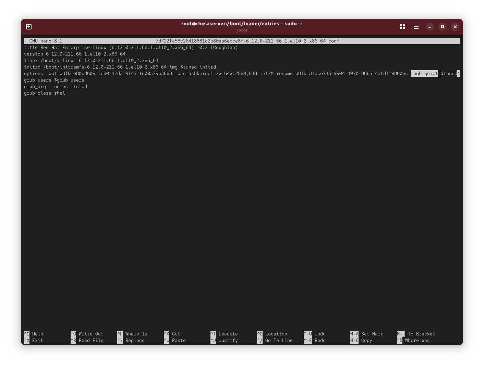
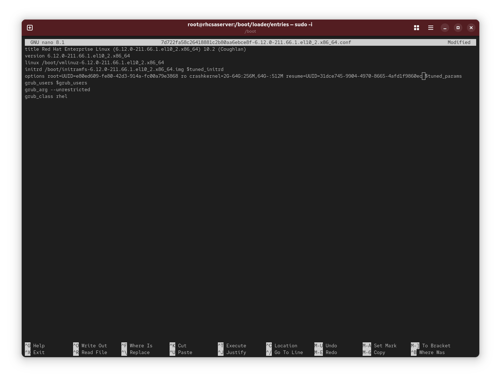
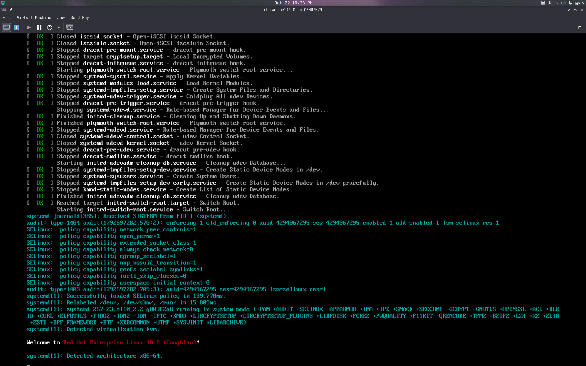

### Task: Lesson 20 Lab - Managing the Boot Procedure

**Goal:** Set the default boot target to `multi-user.target` (no GUI), and persistently remove the `rhgb quiet` kernel parameters so boot messages are visible on startup.

**Solution:**

1. Check the current default boot target, then switch it to `multi-user.target`:
```bash
systemctl get-default
systemctl set-default multi-user.target
systemctl get-default
```
<p align="center">
  
</p>

2. Verify the system boots into `multi-user.target` with no GUI:
<p align="center">
  
</p>

3. Find the current running kernel version to locate its boot entry config file:
```bash
uname -r
```
Then match the output against the files in `/boot/loader/entries/` to find the correct config file.
<p align="center">
  
</p>

4. Open the kernel boot entry config file to inspect the default parameters:
```bash
/boot/loader/entries/<kernelVersion>.conf
```
<p align="center">
  
</p>

5. Remove the `rhgb` and `quiet` parameters from the `options` line in the same config file to make boot messages visible on next boot:

<p align="center">
  
</p>

6. Reboot and verify that detailed boot messages are now shown:
<p align="center">
  
</p>
