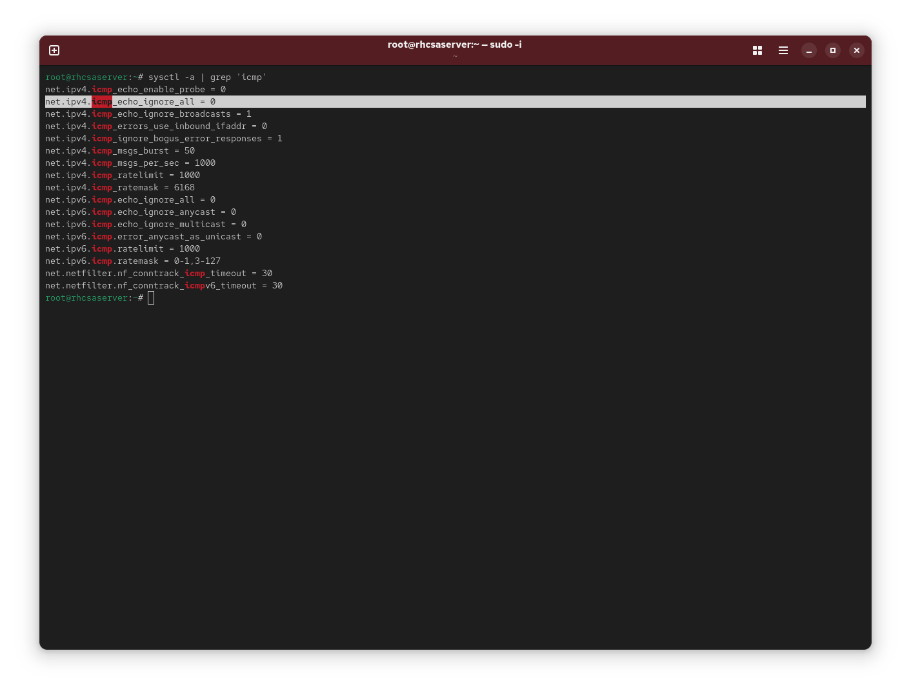
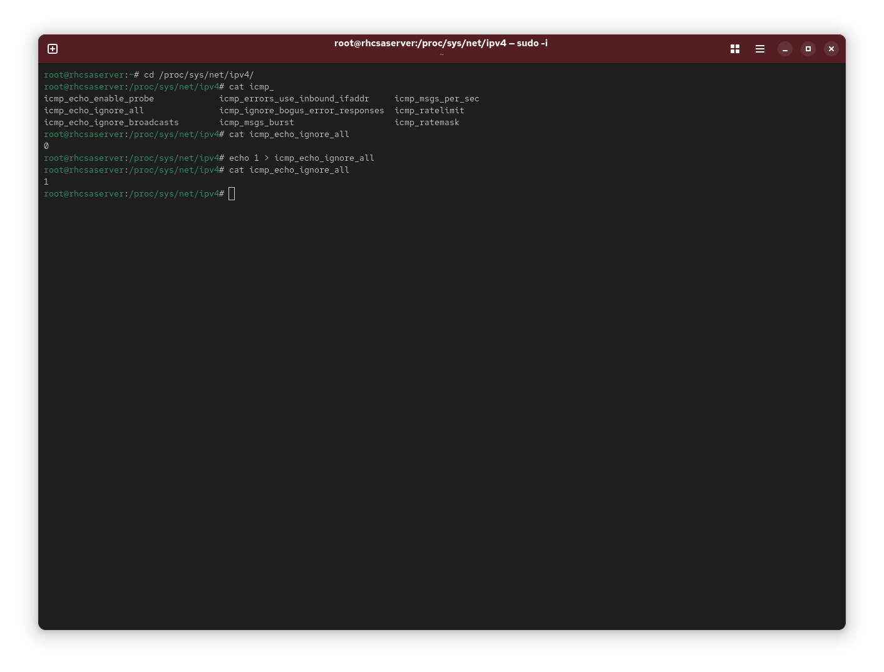
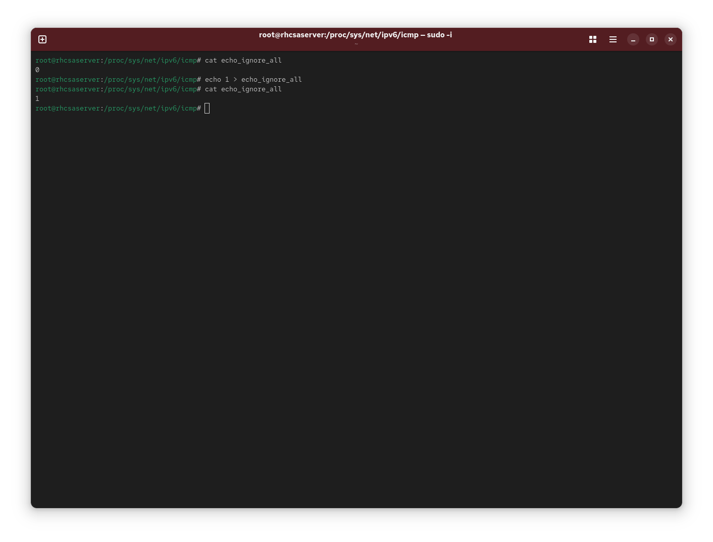
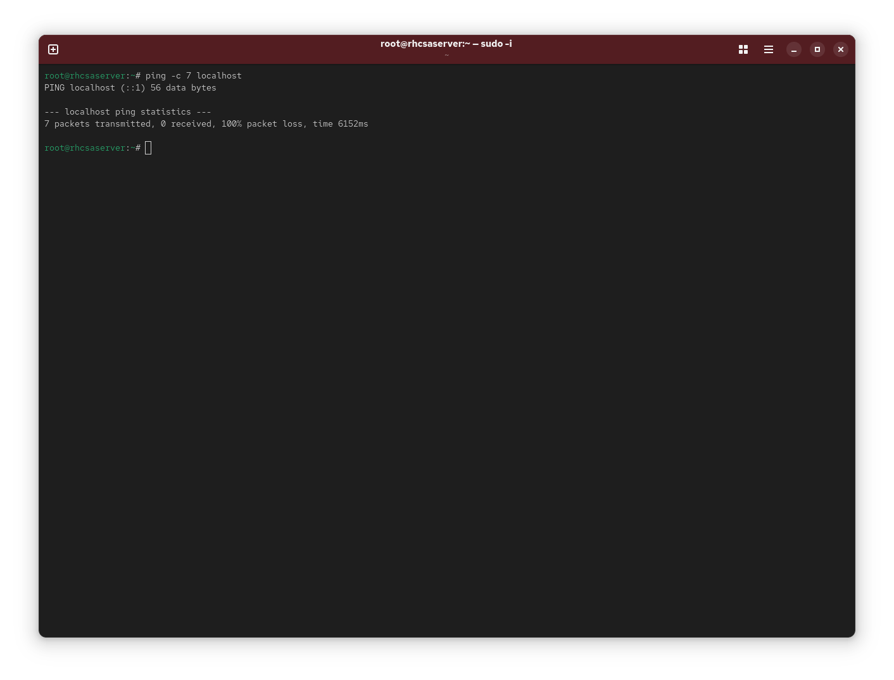
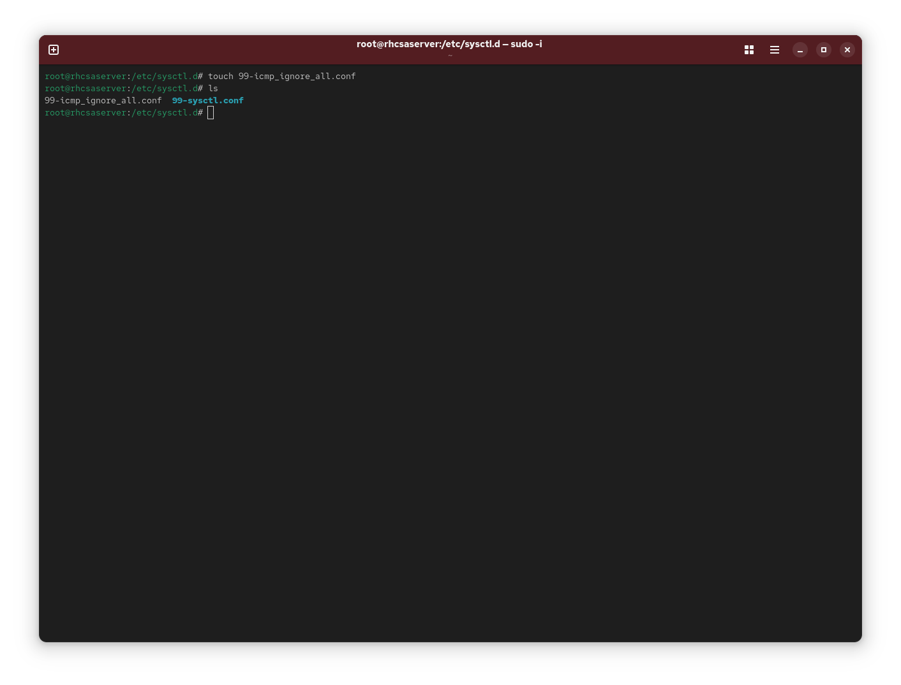
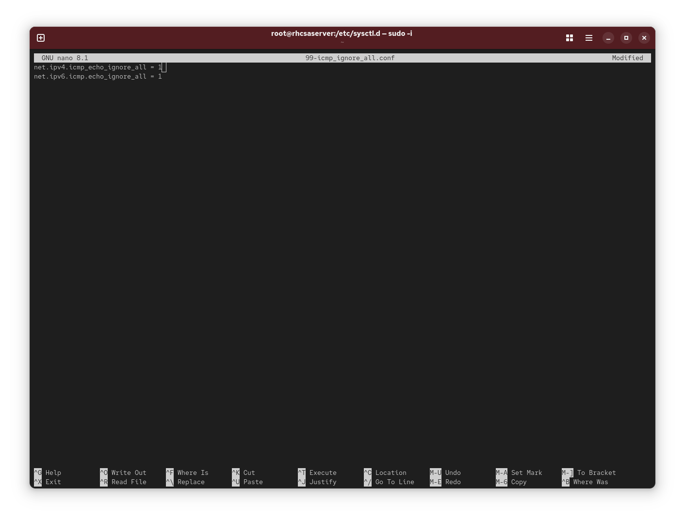
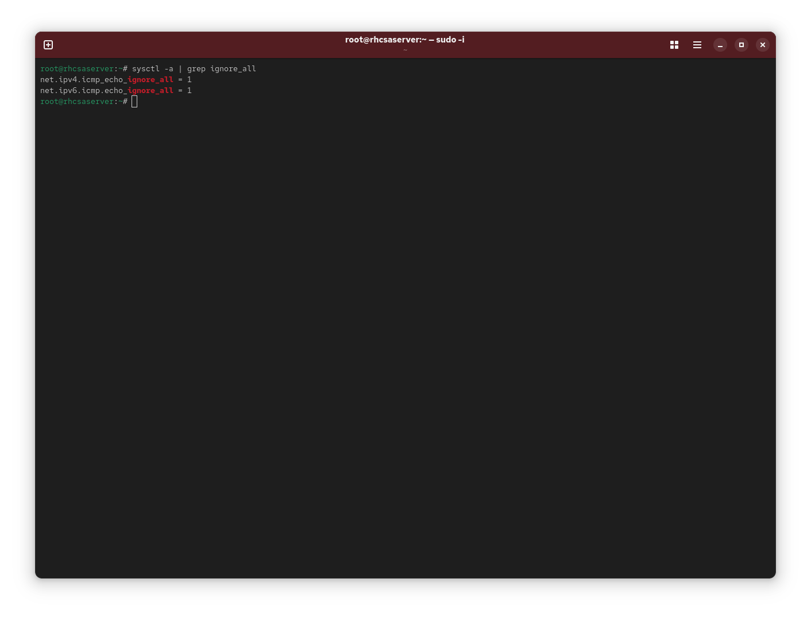

### Task: Lesson 21 Lab - Managing Kernel Parameters

**Goal:** Find the appropriate kernel parameter to disable responses to ping requests for both IPv4 and IPv6, apply it temporarily via `/proc`, make it persistent via `/etc/sysctl.d/`, and verify it works.

**Solution:**

1. Search the live kernel parameters to find the relevant ICMP setting:
```bash
sysctl -a | grep icmp
```
<p align="center">
  
</p>

2. Temporarily disable IPv4 ping responses by writing directly to the `/proc` filesystem:
```bash
cat /proc/sys/net/ipv4/icmp_echo_ignore_all
echo 1 > /proc/sys/net/ipv4/icmp_echo_ignore_all
cat /proc/sys/net/ipv4/icmp_echo_ignore_all
```
<p align="center">
  
</p>

3. Do the same for IPv6:
```bash
cat /proc/sys/net/ipv6/icmp/echo_ignore_all
echo 1 > /proc/sys/net/ipv6/icmp/echo_ignore_all
cat /proc/sys/net/ipv6/icmp/echo_ignore_all
```
<p align="center">
  
</p>

4. Test that ping requests are now ignored:
```bash
ping -c 7 localhost
```
*(No packets should be received.)*
<p align="center">
  
</p>

5. Make the settings persistent by creating a drop-in config file in `/etc/sysctl.d/`:
```bash
touch /etc/sysctl.d/99-icmp_ignore_all.conf
```
<p align="center">
  
</p>

6. Add both IPv4 and IPv6 ignore rules to the config file:
```text
net.ipv4.icmp_echo_ignore_all = 1
net.ipv6.icmp.echo_ignore_all = 1
```
<p align="center">
  
</p>

7. Verify the parameters are correctly applied:
```bash
sysctl -a | grep ignore_all
```
<p align="center">
  
</p>
