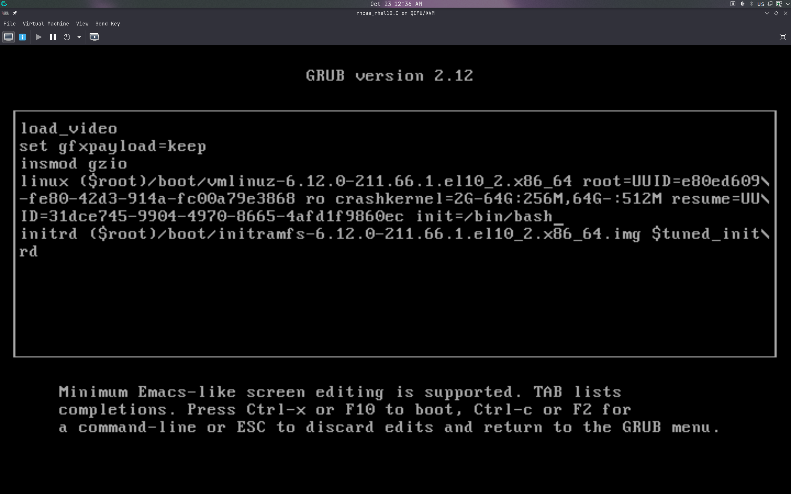
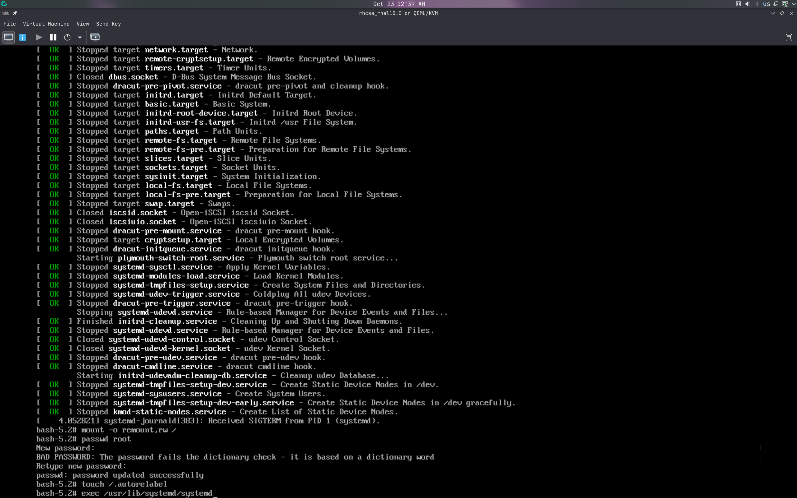

### Task: Lesson 22 Lab - Recovering a Lost Root Password

**Goal:** Recover access to a system where the root password has been lost by interrupting the boot process and resetting the password from a minimal shell.

**Solution:**

1. Reboot the system and interrupt the GRUB boot menu. Select the kernel entry and press `e` to edit it. Find the line starting with `linux` and append the following to the end of it:
```text
init=/bin/bash
```
*(This replaces systemd with a bare bash shell, giving direct root access at boot without requiring a password.)*
<p align="center">
  
</p>

2. Press `Ctrl+X` to boot with the modified parameters. Once at the shell, remount the root filesystem as read-write, reset the root password, flag the filesystem for SELinux relabeling, then hand off to systemd to complete a normal boot:
```bash
mount -o remount,rw /
passwd root
touch /.autorelabel
exec /usr/lib/systemd/systemd
```
*(The `/.autorelabel` file is required so SELinux re-applies correct labels after the filesystem was modified outside of a normal boot.)*
<p align="center">
  
</p>
