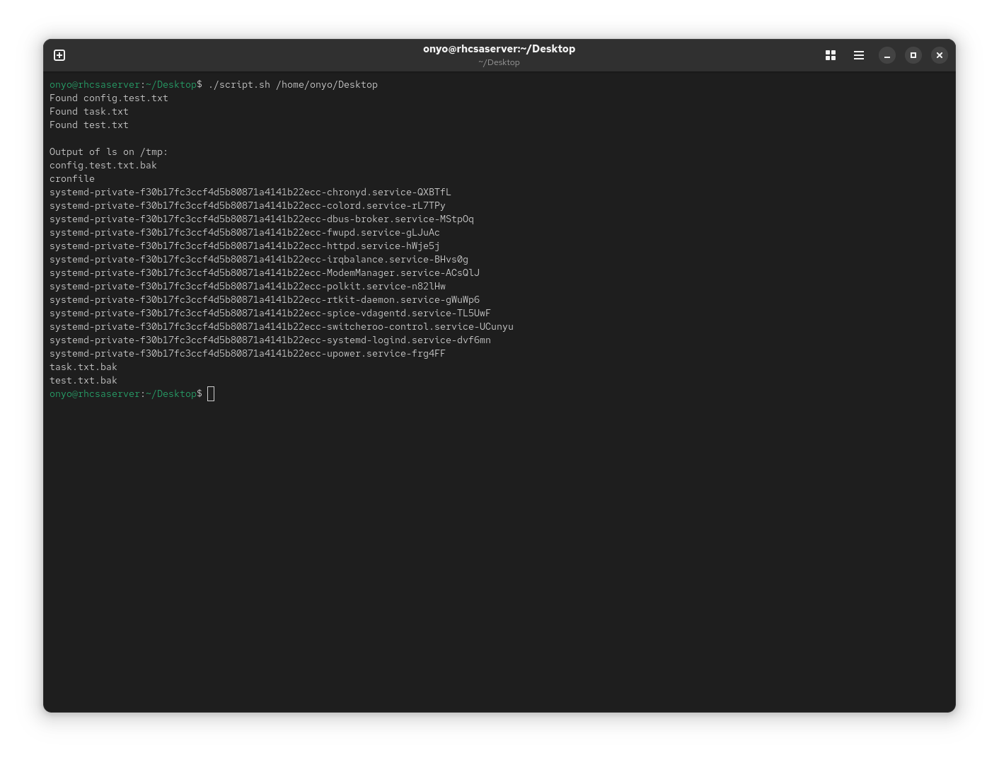

### Task: Lesson 23 Lab - Writing Shell Scripts

**Goal:** Write a script that finds all `*.txt` files in a directory passed as an argument, copies each one with a `.bak` extension, and moves the backup to `/tmp`. If no argument is provided, the script exits with code `9`.

**Solution:**

**Script file: `script.sh`**
```bash
#!/bin/bash

if [ -z $1 ]
then
    echo 'Please provide location of the files as first argument'
    exit 9
fi

LOCATION=$1

cd $LOCATION

for file in *
do
    if [ "${file: -4}" == ".txt" ] && [ -f $file ]
    then
        echo Found $file
        cp $file $file.bak
        mv $file.bak /tmp
    fi
done

echo
echo "Output of ls on /tmp:"
echo "$(ls /tmp)"
```

Run the script by passing the target directory as an argument:
```bash
./script.sh /home/onyo/Desktop
```
<p align="center">
  
</p>
