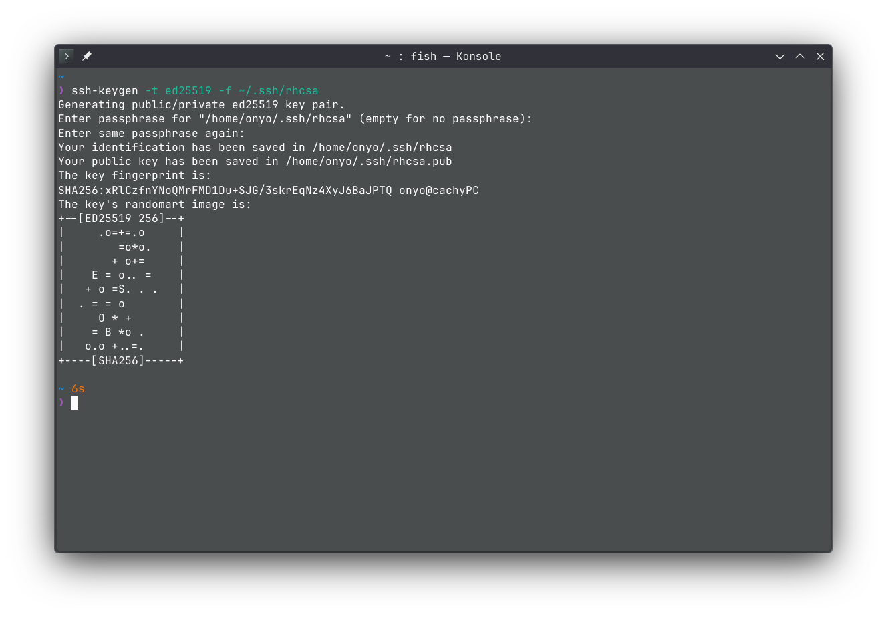
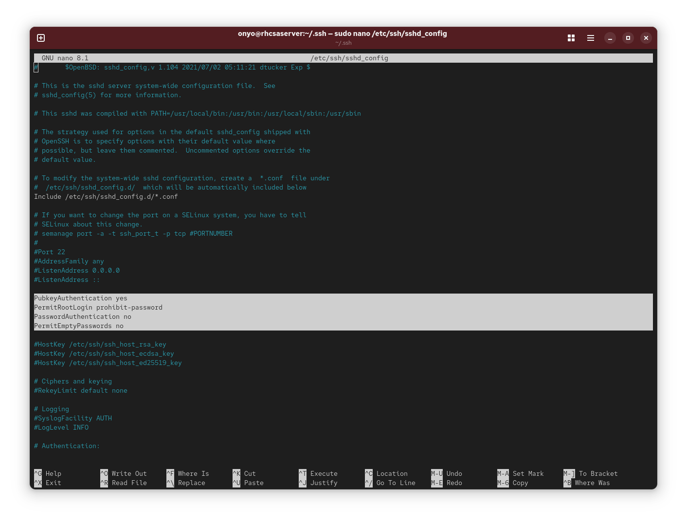
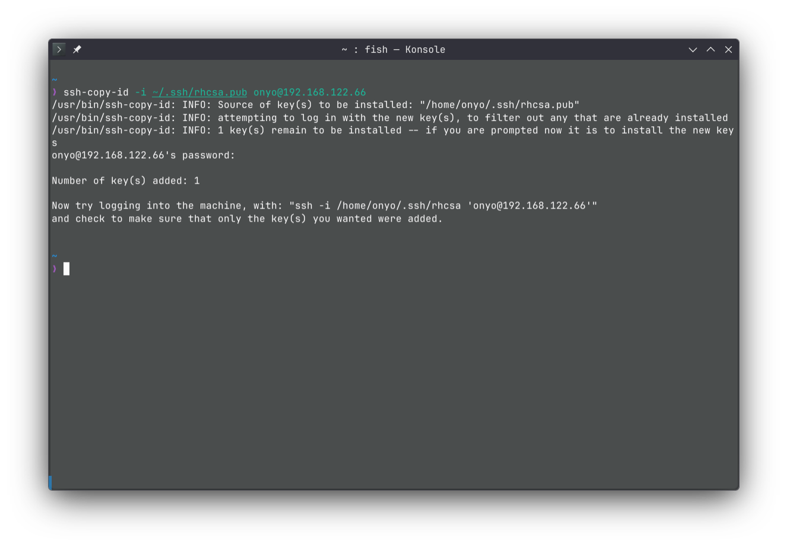
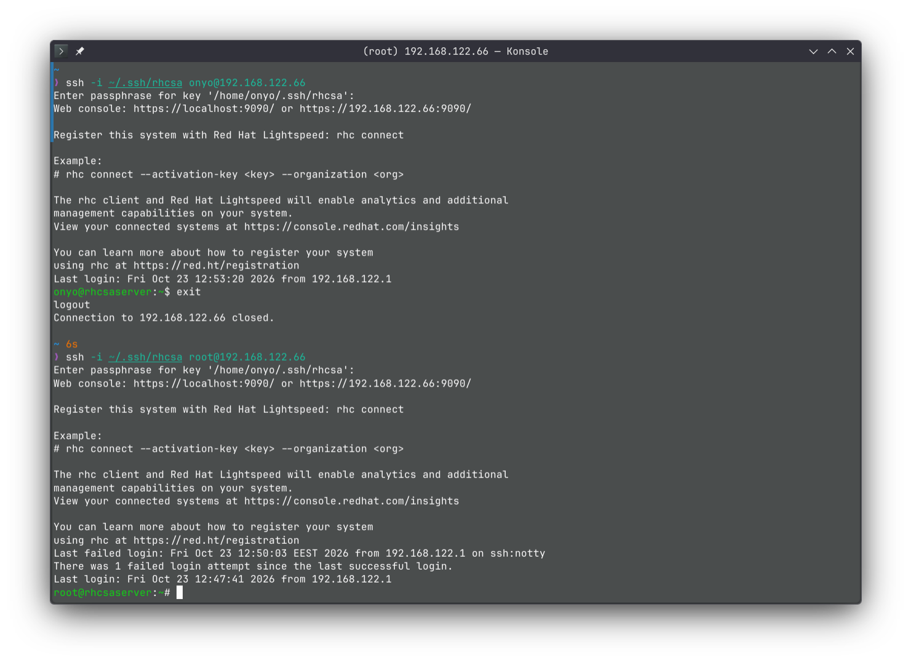

### Task: Lesson 24 Lab - Managing SSH

**Goal:** Configure the SSH server to allow root login via public key authentication only, disable password authentication, generate an SSH key pair, and verify key-based login works for both `onyo` and `root`.

**Solution:**

1. Generate a new ED25519 SSH key pair:
```bash
ssh-keygen -t ed25519 -f ~/.ssh/rhcsa
```
<p align="center">
  
</p>

2. Edit `/etc/ssh/sshd_config` to configure the SSH server - enable public key authentication, allow root login via key only, and disable password authentication:
```text
PubkeyAuthentication yes
PermitRootLogin prohibit-password
PasswordAuthentication no
PermitEmptyPasswords no
```
<p align="center">
  
</p>

3. Copy the public key to the `onyo` user's authorized keys on the server:
```bash
ssh-copy-id -i ~/.ssh/rhcsa.pub onyo@192.168.122.66
```
<p align="center">
  
</p>

4. Copy the public key to the `root` user's authorized keys on the server:
```bash
ssh-copy-id -i ~/.ssh/rhcsa.pub root@192.168.122.66
```
<p align="center">
  
</p>

5. Test key-based SSH login for both users:
```bash
ssh -i ~/.ssh/rhcsa onyo@192.168.122.66
ssh -i ~/.ssh/rhcsa root@192.168.122.66
```
<p align="center">
  
</p>
