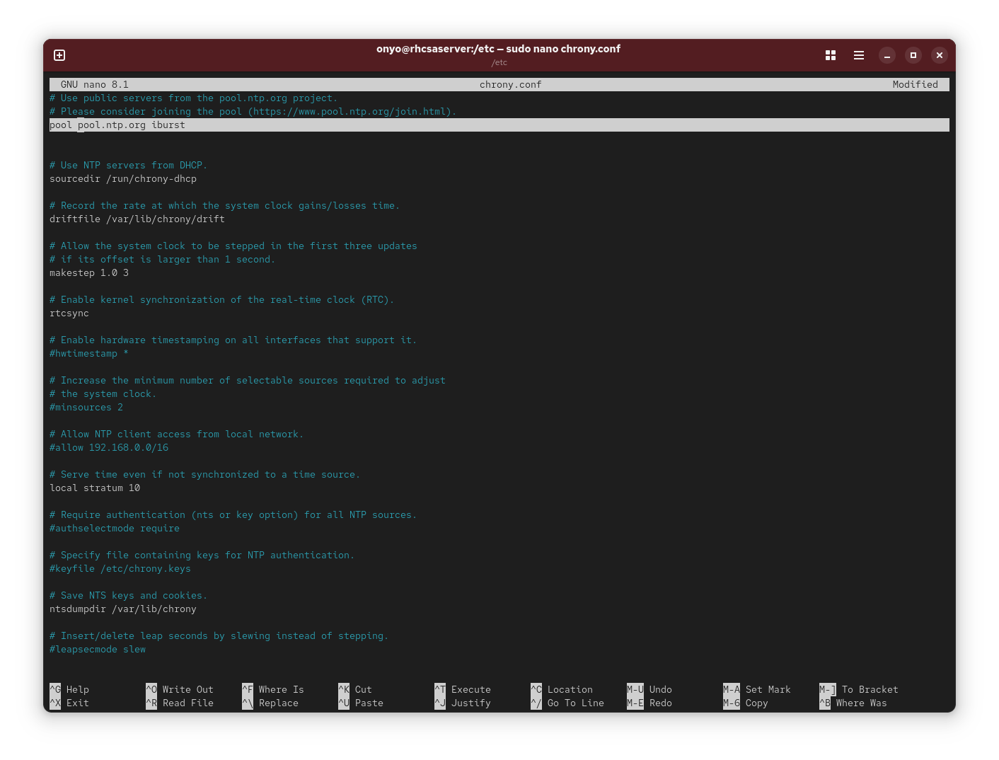
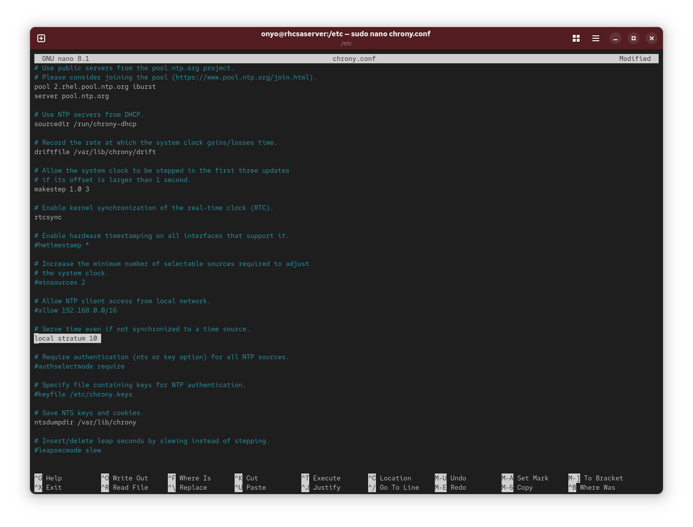
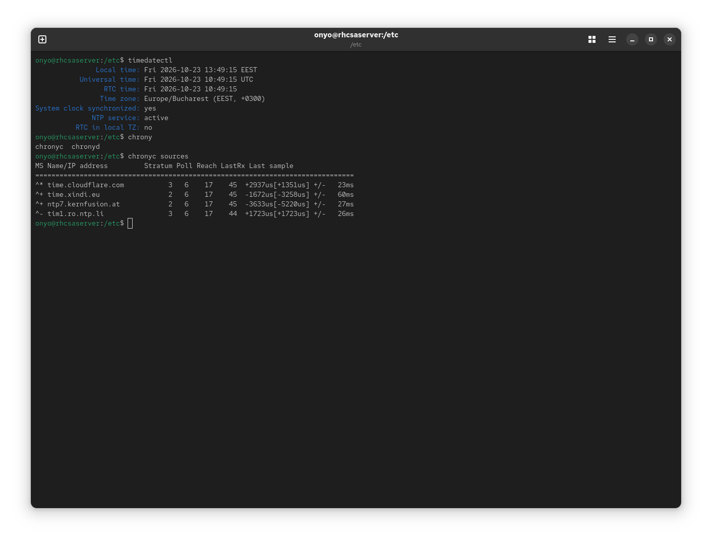

### Task: Lesson 26 Lab - Configuring Time Services

**Goal:** Configure the system to synchronize time with `pool.ntp.org`, and advertise itself as a stratum 10 NTP server for local clients.

**Solution:**

1. Add the `pool.ntp.org` pool to `/etc/chrony.conf` to enable time synchronization:

<p align="center">
  
</p>

2. Also add the following line to `/etc/chrony.conf` to advertise this host as a local NTP server at stratum 10:
```text
local stratum 10
```
<p align="center">
  
</p>

3. Restart `chronyd` to apply the changes, then verify time synchronization is working:
```bash
timedatectl
chronyc sources
```
<p align="center">
  
</p>
