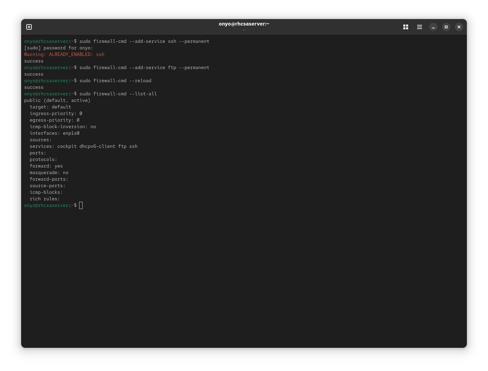

### Task: Lesson 28 Lab - Configuring a Firewall

**Goal:** Configure `firewalld` to permanently allow remote access to SSH and FTP services, applying the rules both immediately and persistently.

**Solution:**

1. Add SSH and FTP services to the firewall permanently, reload to apply immediately, then verify the active rules:
```bash
sudo firewall-cmd --add-service ssh --permanent
sudo firewall-cmd --add-service ftp --permanent
sudo firewall-cmd --reload
sudo firewall-cmd --list-all
```
*(Using `--permanent` writes the rule persistently, and `--reload` activates it in the running configuration without a reboot.)*
<p align="center">
  
</p>
