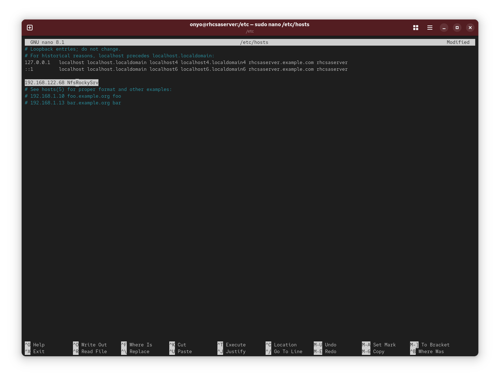
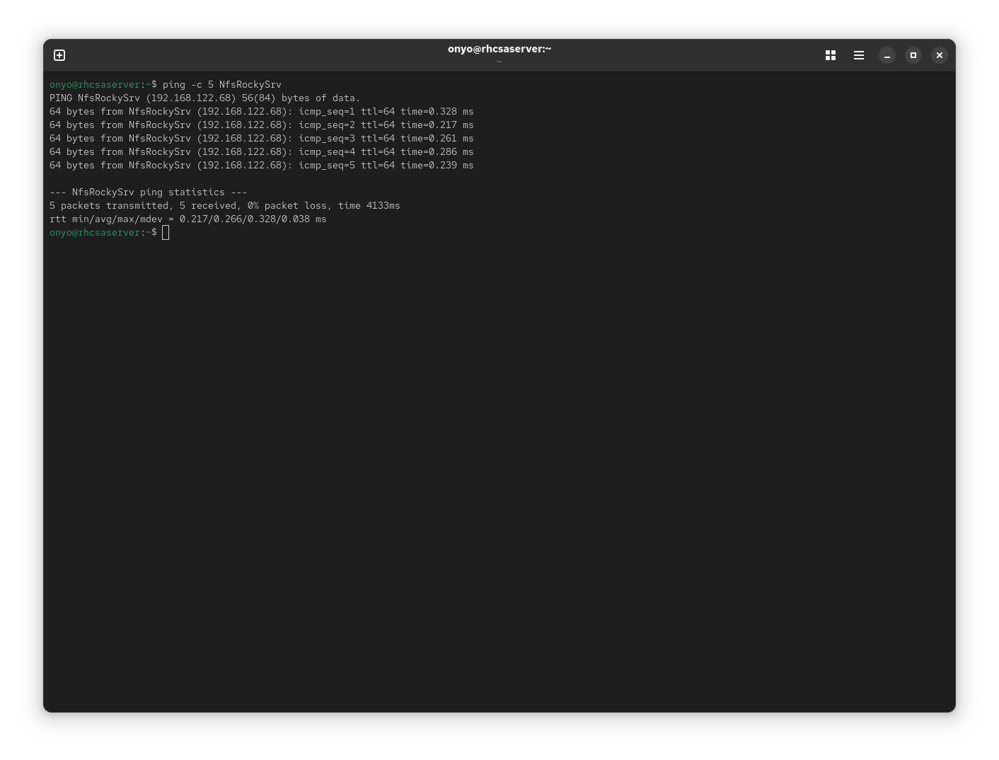
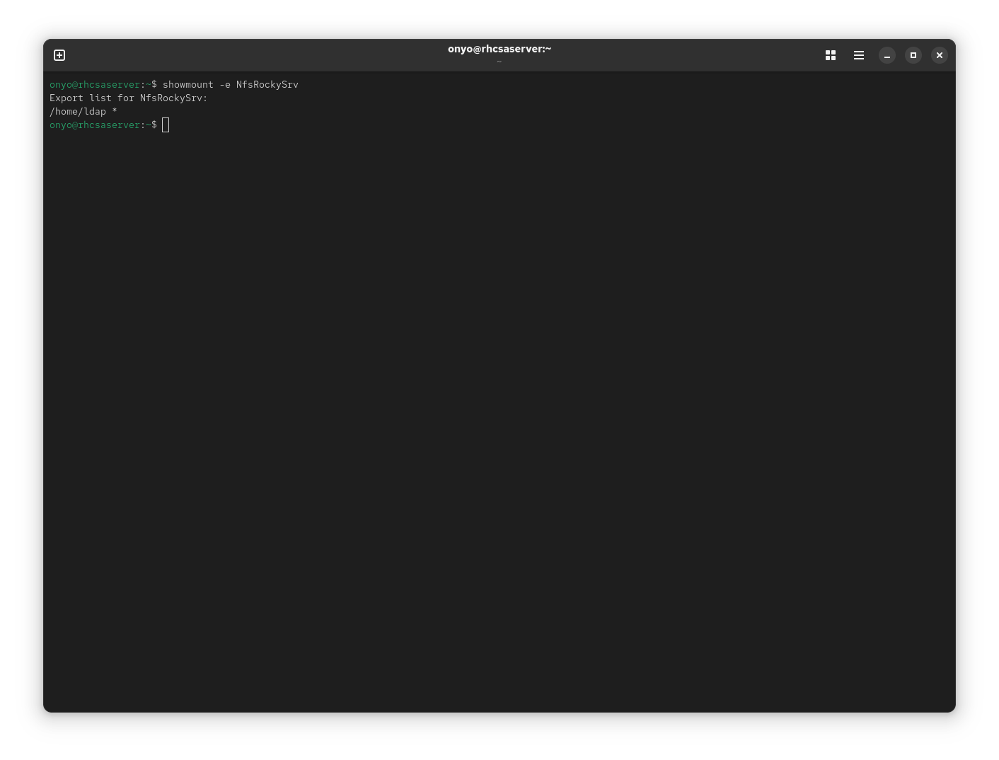
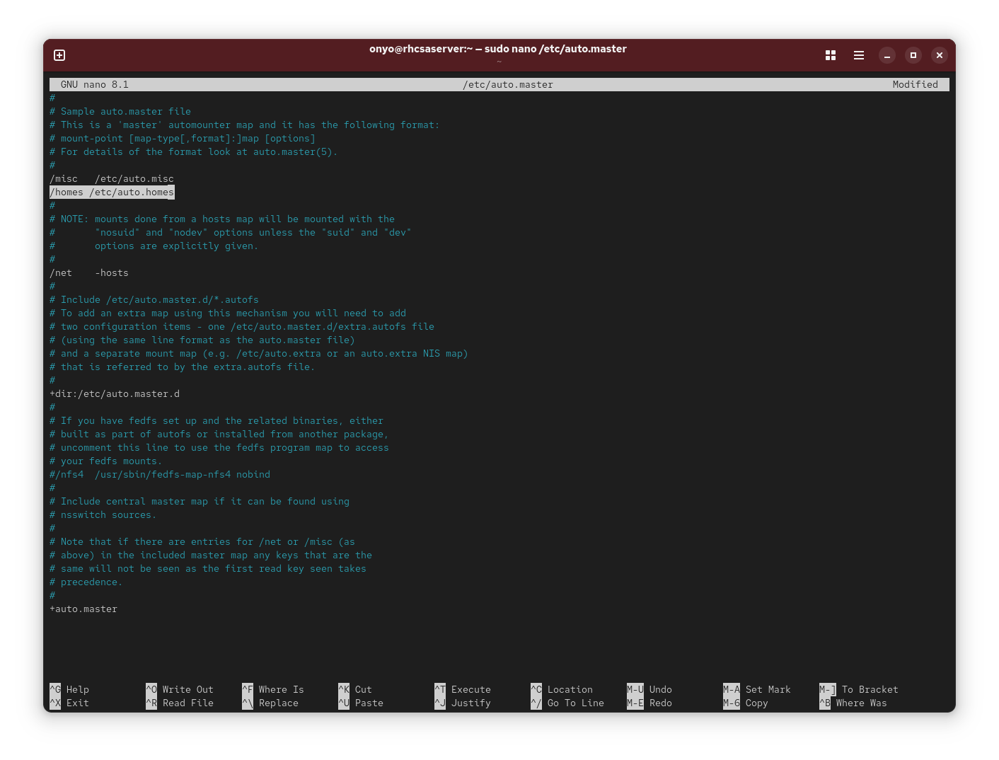
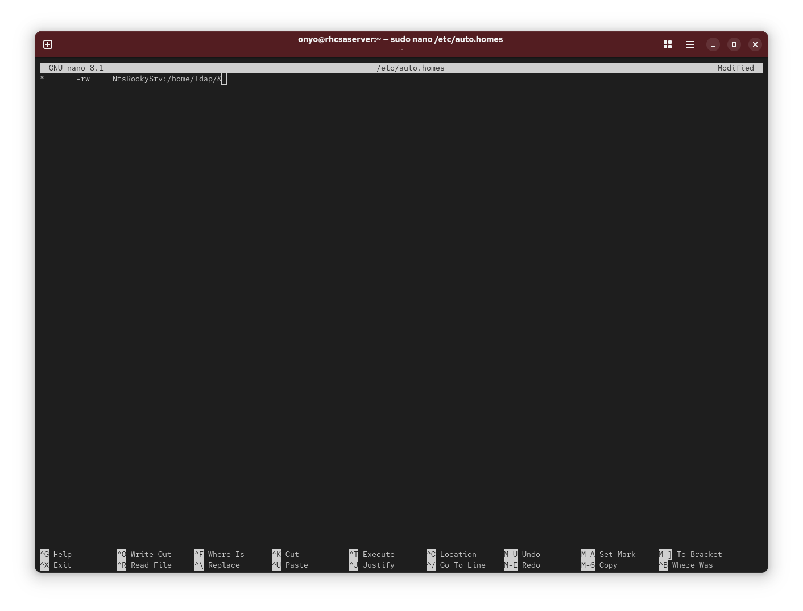
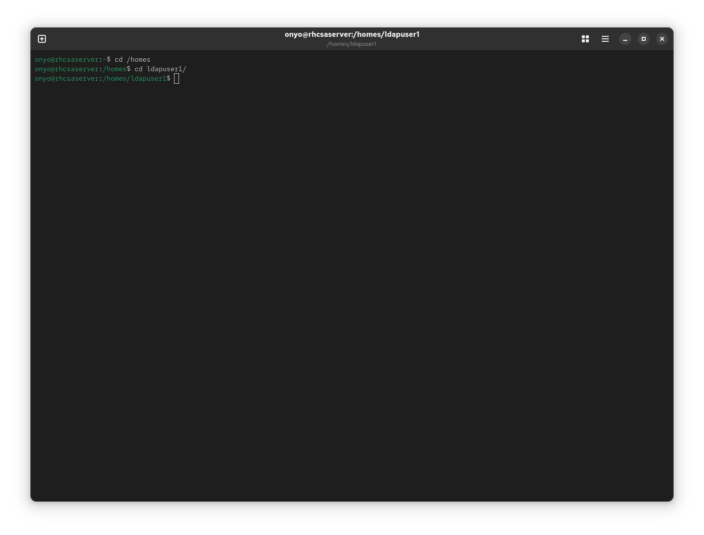
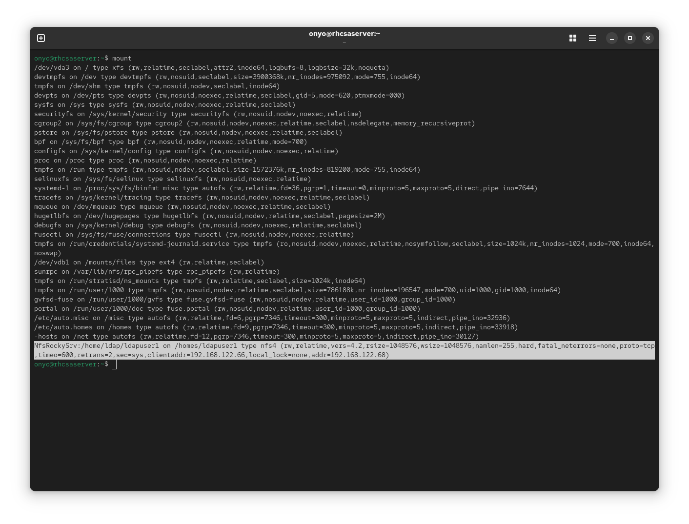

### Task: Lesson 29 Lab - Setting up Autofs

**Goal:** Configure autofs to automatically mount NFS home directories from a remote NFS server so that accessing `/homes/ldapuserN` triggers an on-demand NFS mount of the corresponding directory.

> [NOTE]
> For this lab, a separate Rocky Linux VM is already configured as the NFS server (`NfsRockySrv`) with `/home/ldap/ldapuser{1..9}` directories created and exported over NFS.

**Solution:**

1. Add the NFS server to `/etc/hosts` for local hostname resolution:
```text
192.168.122.68  NfsRockySrv
```
<p align="center">
  
</p>

2. Verify connectivity to the NFS server:
```bash
ping -c 5 NfsRockySrv
```
<p align="center">
  
</p>

3. Check what directories the NFS server is exporting:
```bash
showmount -e NfsRockySrv
```
<p align="center">
  
</p>

4. Add an entry to `/etc/auto.master` to tell autofs to manage the `/homes` directory using the `/etc/auto.homes` map file:
```text
/homes  /etc/auto.homes
```
<p align="center">
  
</p>

5. Create `/etc/auto.homes` with a wildcard rule to dynamically mount any `ldapuserN` directory from the NFS server on access:
```text
*   -rw     NfsRockySrv:/home/ldap/&
```
*(The `*` matches any subdirectory name and `&` substitutes it into the NFS path, so accessing `/homes/ldapuser1` mounts `NfsRockySrv:/home/ldap/ldapuser1`.)*
<p align="center">
  
</p>

6. Navigate into a user's home directory to trigger the automount, then verify the NFS mount is active:
```bash
cd /homes
cd ldapuser1/
```
<p align="center">
  
</p>

```bash
mount
```
*(Check the last entry - the NFS mount)*
<p align="center">
  
</p>
