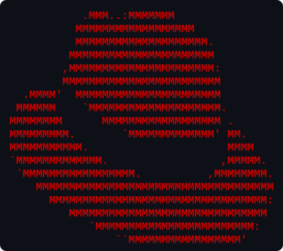

  
  <h1>RHCSA Study Notes & Labs</h1>

This repository contains lab solutions for the **Red Hat Certified System Administrator (RHCSA)** course by **Sander van Vugt**.

## Useful Links

- [Sander van Vugt RHCSA Video Course (Pearson IT Certification)](https://www.pearsonitcertification.com/store/red-hat-rhcsa-rhel-10-with-exam-labs-pearson-cert-prep-9780135493106)
- [Sander van Vugt RHCSA Video Course (O'Reilly)](https://learning.oreilly.com/course/red-hat-rhcsa/9780135493137/)
- [RHCSA (EX200) Exam Details](https://www.redhat.com/en/services/training/ex200-red-hat-certified-system-administrator-rhcsa-exam)
- [Red Hat Enterprise Linux Documentation](https://access.redhat.com/documentation/en-us/red_hat_enterprise_linux/)
- [Red Hat Developer Program](https://developers.redhat.com/)
